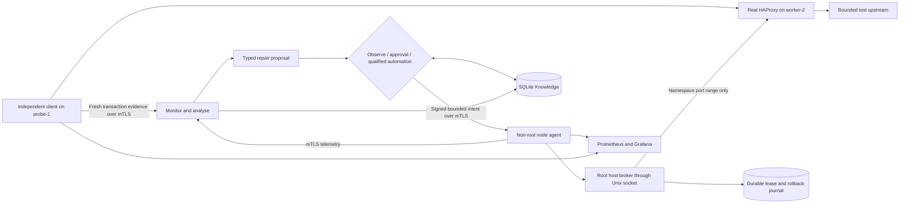

# HAProxy gateway self-healing with MAPE-K

A research prototype that restores a real HTTP gateway's outgoing connection capacity without restarting the gateway. The motivating scenario is a bank's gateway during a retail traffic peak. The lab uses fictional, nonce-checked HTTP transactions; it processes no payments or customer data.

## Exactly what is healed

HAProxy forwards requests to an upstream. Each outgoing TCP connection needs a local source port. In a deliberately small, isolated namespace the approved pool has 32 port numbers. Bounded background connections can exhaust that pool, causing real client requests to fail. The healer correlates failures, proposes expanding the pool to 256, applies the temporary change after authorisation, then verifies fresh client requests while the load continues. HAProxy keeps the same process identity throughout.

An unavailable upstream, missing observations, insufficient memory or a reserved-port conflict must **not** trigger this repair. Enlarging a port pool cannot fix those problems.

## Structure

The controller runs in Kubernetes; HAProxy is a constrained host service in its own network namespace. Kubernetes hosts the control software, rather than being the failure being repaired. The broker has a fixed protocol and root-owned policy, not an arbitrary command interface. The controller and agent have no Kubernetes API token or CloudStack credential.

## Human control and learning

The optional [human-reviewed Gemini investigation](docs/ai-investigation.md) explains incident evidence and suggests next checks without repair authority. Operators can record manual repairs and their verification evidence. These notes do not qualify automatic procedures. Provider use is disabled until configured; tests with a fake provider are not evidence of live model accuracy.

The [repeated diagnosis-quality comparison](evidence/diagnosis-quality.md) includes 42 real Gemini calls on seven constructed cases. Refined guidance improved full-report rubric compliance from two to six cases; technical caveats and single-reviewer/in-sample limits remain. Fresh-evidence admission and local safety notices protect the workflow independently of model obedience.

- **Observe:** collect evidence and proposals, execute nothing.
- **Require approval:** a named operator authorises a bounded repair with a reason.
- **Use validated procedures:** reuse only a procedure explicitly promoted after two distinct verified occurrences in the same identity/policy scope.

The gateway requires two consecutive diagnostic observations, then three distinct independent successful checks over at least two seconds for verification. Root-enforced leases, cooldown, fresh admission checks and compare-and-set rollback constrain changes. Failed verification suspends reuse. Learning means remembering verified procedures and their applicability, not LLM training or inventing arbitrary fixes.

## Use it and evaluate it

1. Read [architecture](docs/architecture.md), [gateway design](docs/gateway-design.md) and [security boundaries](docs/security.md).
2. Run `python -m unittest discover -s tests -v`.
3. Follow the administrator-only [installation](docs/install.md) and [demo protocol](docs/demo.md).
4. Read [validation](evidence/validation.md) and [research interpretation](docs/research.md). Detailed histories, keys and recovery archives remain private/off-platform.

The live comparison is `experiments/gateway_study.py`: the same bounded load under observe-only, reviewed and automatic control. Scripted approvals are labelled laboratory actions, not measured human response times. The older port/descriptor fixtures remain regression code and historical evidence; they are not additional active products or the primary gateway result.

The follow-up [hard-restart comparison](evidence/restart-comparison.md) tests the simpler alternative: three paired trials under continuing load. Hard restart achieved no sustained recovery; targeted repair recovered in all three trials, with fewer pending-request interruptions. This result is specific to the deliberately constrained lab, not a claim that restarting is always wrong or that a known static setting needs an entire healer.

Support is limited to the qualified Ubuntu 24.04 / Linux 6.8 / K3s lab. No claim of universal deployment, high availability, DORA compliance, production readiness, 50,000 requests/second or zero loss is made. The real gateway uses a synthetic bounded upstream; an enterprise gateway and workload need their own qualification. Original code is MIT licensed; upstream software retains its licences.
