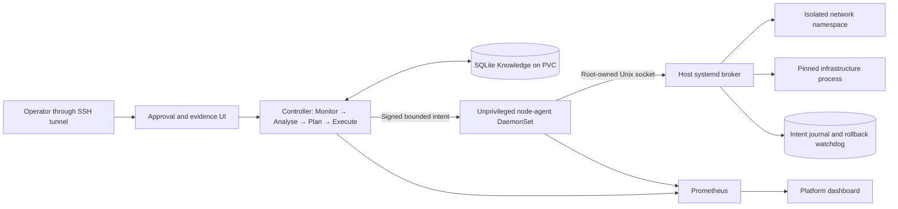

# Autonomous Kernel & Platform Tuning Engine

A MAPE-K research prototype for **live Linux infrastructure resource saturation on Kubernetes**. It repairs a resource boundary without restarting the affected process or Kubernetes node.

The motivating use case is a bank's gateway platform under retail-event connection pressure. There is no banking application, payment processing or customer dataset in this repository. The patient is the platform's networking and process-resource layer.

## What it currently heals

| Controlled failure | Detection | Bounded repair | Proof of recovery |
|---|---|---|---|
| Outbound source-port exhaustion | High occupancy **and new `EADDRNOTAVAIL` allocation failures** | Expand an approved range in a dedicated loopback-only network namespace | Required connections established plus a fresh independent echo transaction |
| Process descriptor exhaustion | Near-soft-limit usage **and new `EMFILE` failures** | Raise that owned process's soft `RLIMIT_NOFILE` within its fixed hard ceiling | Required descriptor allocations succeed, same process identity, runtime limit readback |
| Storage/control-plane pressure | Capability discovery; existing node-exporter/PSI telemetry | Investigation only in this release | No claim of repaired etcd or effective I/O priority |

**Support boundary:** Ubuntu 24.04 / Linux 6.8 / K3s lab; two administrator-owned, bounded infrastructure fixtures. Production process discovery, generic gateway integration, OKD/SCC qualification, HA and production TLS are not implemented. Do not deploy this release as an unattended production node tuner.

## Architecture

The controller and agent have no Kubernetes API credentials or RBAC grants. Neither can delete workloads, restart nodes or invoke CloudStack. The broker accepts two fixed operations, never shell commands. Its signing key is unavailable to the agent. The host broker is an explicit administrator installation, not a privileged container with the host filesystem exposed.

First occurrences require human approval. Two **distinct, verified occurrences** make a procedure eligible for explicit promotion. A later matching incident can reuse it automatically within the exact identity/policy scope. Failed verification suspends reuse. This is procedural learning, not LLM training or discovery of arbitrary repairs.

## Start here

1. Read [the architecture specification](docs/architecture.md), [support and security limits](docs/security.md), and [the research argument](docs/research.md).
2. Run offline checks: `python -m unittest discover -s tests -v`.
3. Follow [installation](docs/install.md). Native components are generated by `manifests/render.py`; host installation is explicit and lab-only.
4. Follow [the demo protocol](docs/demo.md). Detailed incident histories, secrets and recovery backups stay off GitHub.

The previous bank-statement/job application, its adapters, demo faults and dashboards are intentionally removed from this branch. Historical results remain in Git history and private backups; they are not evidence for this engine.

## Evidence

See [the live validation record](evidence/validation.md) for observed results and limitations. Configuration success is not evidence of useful recovery. A fresh echo/allocation check is required after mutation, and rollback must be observed after draining the fixture.

MIT-licensed original code; Python, Linux, Kubernetes, K3s, Prometheus and Grafana retain their own upstream licences. No proprietary AI provider is required. This prototype does not establish production readiness, DORA compliance, 50,000 requests/second capacity or zero packet loss.
