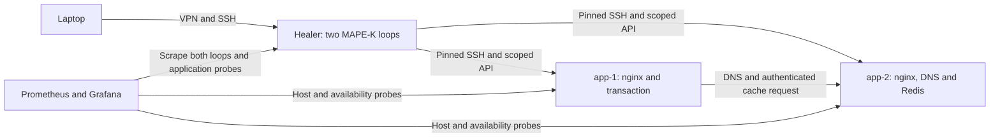

# Self-healing infrastructure on EduCloud

A working MAPE-K research lab on four Ubuntu VMs. It diagnoses failures,
proposes bounded repairs, verifies the outcome and stores reviewed procedures
for later reuse. Unknown failures require investigation. It is a prototype
with a finite repair capability set, not general autonomous administration.

## Current lab

| VM | Address | Purpose |
|---|---|---|
| healer-ubuntu | 10.1.1.205 | Two MAPE-K services, incident review, SQLite Knowledge, optional Gemini advice |
| app-1 | 10.1.1.60 | nginx; synthetic DNS/Redis/checkpoint transaction on 8088 |
| app-2 | 10.1.1.61 | nginx; dedicated DNS on 1053 and authenticated Redis on 6380 |
| monitor | 10.1.1.50 | Prometheus, blackbox exporter and read-only Grafana |

These are systemd services on VMs, not containers. Only healer SSH has a
gateway port forward. Laptop access uses EduCloud VPN and verified SSH keys.
The healer manages app VMs over the isolated 10.1.1.0/24 network.



The nginx loop exposes metrics on 9105 and normally observes through Prometheus,
with direct checks for verification. The infrastructure loop exposes 9106 and
uses direct dependency checks. It treats both app VMs as one managed transaction.

## Read first

- [Current architecture and system explanation](docs/architecture.md)
- [Personal infrastructure demonstration](docs/infrastructure-lab.md)
- [Nginx incident approval and recorded human repairs](docs/operator-workflow.md)
- [Current access and recovery runbook](docs/healer-handover.md)
- [Research answers, literature and limitations](docs/research-synthesis.md)
- [Repository audit and verification](docs/repository-audit.md)
- [Historical nginx A/B/C results](docs/results.md)

## What learning means here

An investigator links an observed failure to a cause and a reviewed repair.
The first repair requires approval. A human repair can also be recorded, but
only independent checks can certify it. Two distinct verified occurrences and
explicit promotion permit automatic reuse within the recorded target, template,
reference and recipe scope. Changed evidence or scope requires review. A failed
automatic repair revokes its procedure; two new verified occurrences are needed.

This is procedural learning stored in SQLite, not training the LLM. Gemini
provides advisory hypotheses and checks. It cannot execute commands or turn its
answer into an infrastructure investigation binding. Broader recipes can
restore DNS configuration, cache budget, checkpoint permissions or a stopped
cache. New capabilities require code review; recipes cannot contain arbitrary
shell commands. Historical simulation/prevention results are separate from the
current reviewed policy.

## Running and checking

On the healer, enter the active checkout shown by `systemctl --user show
healer-loop healer-infrastructure -p WorkingDirectory`. See the handover for
the verified deployment paths. Open a credential-bearing shell without printing
credentials, then inspect each layer:

```bash
python3 tools/lab_shell.py
python3 tools/lab.py status
bash tools/start_loop.sh status
bash tools/start_infrastructure.sh status
python3 tools/infrastructure.py status
python3 tools/infrastructure.py list
python3 tools/infrastructure.py procedures
```

Credentials are supplied through environment variables and the user service
manager; they are not committed. A reboot requires entering them again.
The cloud keypair resource is `healer-lab-key2`; the healer's lab private key is
`~/.ssh/healer-lab-key`. The baseline template is plain Ubuntu: it needs both
nginx/exporter provisioning and the infrastructure installer after a rebuild.
Never reset app-1/app-2 while the dependency lab is in use.

Offline regression checks do not call EduCloud:

```bash
python3 tools/test_safety.py
python3 tools/test_learning.py
python3 tools/test_adapter.py
python3 tools/test_operator.py
python3 tools/test_infrastructure.py
python3 tools/test_transaction.py
python3 tools/test_repository.py
bash tools/test_lab_host.sh
```

`tools/demo.py` and `tools/experiment.py` use the simulator. Live exercises are
explicitly named and documented. The historical `live_experiment.py` resets a
VM and bypasses today's review policy; it requires an explicit historical-mode
flag and refuses a running infrastructure loop or production incident state.

## Evidence boundaries

The broader lab has demonstrated four injected fault classes and reviewed
reuse. The small concurrency sweep measures one transaction on two application
VMs, not fleet scalability. Historical results, failed trials and raw logs are
preserved, rather than edited to fit current behavior. Availability, backup and
project retention are not guaranteed by EduCloud: retain code and evidence
off-platform. Fault injection and security experiments stay inside this lab.
