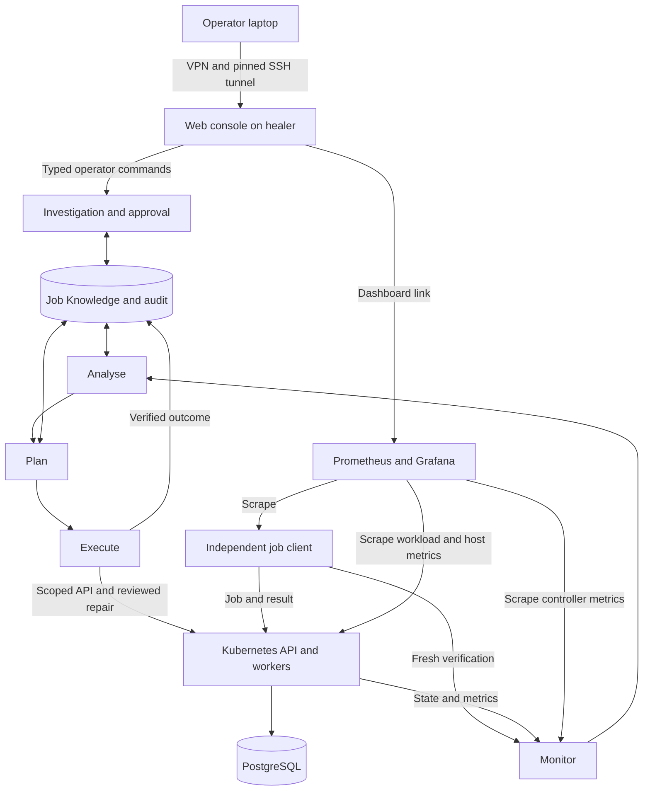

# Current architecture: one job-processing application

Read [the use case](focused-use-case.md) for the requirement and
[the console runbook](web-console.md) for operator actions and access.

| Layer | Implementation | Responsibility |
|---|---|---|
| Operator | Private console on healer loopback 8085 | Evidence, investigation, approval, manual repair verification, promotion |
| Control | `mapek/loop.py`, `stages.py`, `jobs.py` | MAPE-K policy, bounded application-aware repairs and verification |
| Knowledge | Job SQLite stores under `state/jobs` | Cases, investigations, audit, advice and procedures |
| Cluster | K3s control .80 and workers .81/.82 | API/worker containers, Pod lifecycle and scheduling |
| Persistence | PostgreSQL on db-1 .83 | Authoritative job state and results |
| Independent checks | probe-1 .84 | Submit jobs, check deadline and hash, retain receipts |
| Observability | monitor .50 | Prometheus, blackbox probes and Grafana |

Addresses use private `10.1.1.0/24`. The healer remains `.205`; laptop access
uses VPN and pinned SSH through `10.53.14.225:22`. The console uses a local SSH
tunnel. No additional public application or administrative ports are required.

Kubernetes restarts failed containers and reconciles declared state. The healer
does not claim those native recoveries as its work. It repairs reviewed
requirements that the declared state violates: restarting a workload with the
wrong database endpoint or memory specification would reproduce the problem.

`tools/jobs_service.py` runs the loop and publishes completed-tick snapshots on
9109. The console reads that snapshot and incident records; it does not run a
second autonomous loop. Operator actions pass through `tools/jobs.py` and
`JobsOperator`. Backend ownership, current-evidence, fixed-capability and fresh
verification guards remain authoritative. AI text and operator notes are data.

The independent client on 9107 checks actual work; database metrics use 9108.
Node exporters show host load, memory and disk. A policy witness checks
permitted database access and forbidden unrelated service access. Unreadable
required probes cannot certify health. Dashboard `selfheal-jobs` is the main
application view and the only provisioned project dashboard.

## Scope and evidence

Seven VMs are active for this one use case. The two old application VMs are
stopped, with their disks preserved outside the active lab. Their metrics,
alerts, dashboards and runnable project entry points have been retired.
Historical evidence is archived on the laptop, not presented as current results.
The shared simulation is an offline test fixture, not another deployed service.

The live report records nine core repair occurrences, one browser-approved
policy repair and native Pod replacement; it does not establish recovery from
every possible fault.

The console is single-operator and loopback only. Generic service onboarding,
free-form contract edits and enterprise deployment are outside this release.
Private-key preservation, credential renewal, backups and off-platform evidence
remain operational requirements. Never commit generated credentials.

## Follow one job through the system

1. An independent client submits a synthetic payload to the API container.
2. The API writes the job to PostgreSQL; a worker container claims it.
3. The worker calculates SHA-256 and records the result in PostgreSQL.
4. The client reads the result, checks the hash and the 30-second deadline.
5. The healer correlates that outcome with Kubernetes settings, worker capacity,
   memory specifications and the private network policy. It investigates a
   mismatch, obtains approval for a reviewed repair, and verifies a fresh job.

| Running VM | Why this use case needs it |
|---|---|
| healer-ubuntu | Controller, incident/repair memory and operator console |
| monitor | Prometheus and the single job-service Grafana dashboard |
| k8s-control | Kubernetes control plane; private API access |
| k8s-worker-1 and k8s-worker-2 | Run API/worker containers on distinct nodes; demonstrate reconciliation |
| db-1 | PostgreSQL job queue, job state and results |
| probe-1 | Independent end-user checks and fresh repair verification |

API and worker replicas belong to one application. The policy-witness Pod checks
its isolation. Kubernetes system Pods (DNS and networking) support the cluster;
they are not additional applications being researched. VM boundaries provide
independent observation and isolate state, management and workloads. This is a
research lab design, not the minimum host count for a production job service.
