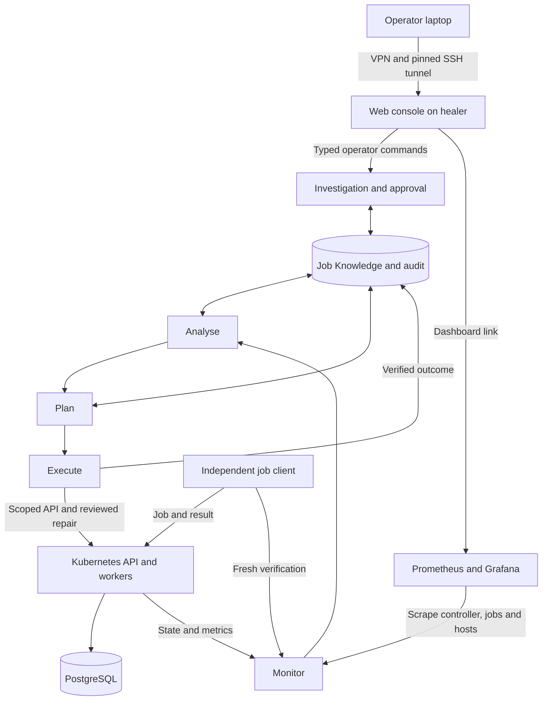

# Current architecture: one job-processing application

Read [the use case](focused-use-case.md) for the requirement and
[the console runbook](web-console.md) for operator actions and access.

| Layer | Implementation | Responsibility |
|---|---|---|
| Operator | Private console on healer loopback 8085 | Evidence, investigation, approval, manual repair verification, promotion |
| Control | `mapek/loop.py`, `stages.py`, `jobs.py` | MAPE-K policy, bounded application-aware repairs and verification |
| Knowledge | Job SQLite stores under `state/jobs` | Cases, investigations, audit, advice and procedures |
| Cluster | K3s control .80 and workers .81/.82 | API/worker containers, Pod lifecycle and scheduling |
| Persistence | PostgreSQL on db-1 .83 | Authoritative job state and results |
| Independent checks | probe-1 .84 | Submit jobs, check deadline and hash, retain receipts |
| Observability | monitor .50 | Prometheus, blackbox probes and Grafana |

Addresses use private `10.1.1.0/24`. The healer remains `.205`; laptop access
uses VPN and pinned SSH through `10.53.14.225:22`. The console uses a local SSH
tunnel. No additional public application or administrative ports are required.

Kubernetes restarts failed containers and reconciles declared state. The healer
does not claim those native recoveries as its work. It repairs reviewed
requirements that the declared state violates: restarting a workload with the
wrong database endpoint or memory specification would reproduce the problem.

`tools/jobs_service.py` runs the loop and publishes completed-tick snapshots on
9109. The console reads that snapshot and incident records; it does not run a
second autonomous loop. Operator actions pass through `tools/jobs.py` and
`JobsOperator`. Backend ownership, current-evidence, fixed-capability and fresh
verification guards remain authoritative. AI text and operator notes are data.

The independent client on 9107 checks actual work; database metrics use 9108.
Node exporters show host load, memory and disk. A policy witness checks
permitted database access and forbidden unrelated service access. Unreadable
required probes cannot certify health. Dashboard `selfheal-jobs` is the main
application view; previous dashboards relate to historical experiments.

## Scope and evidence

Five application-supporting VMs were added to the original four-machine lab.
The two old app VMs remain historical fixtures. Their evidence must be preserved;
their controllers are stopped and disabled after backup and live verification.
Their two inactive controller scrape jobs were retired; host monitoring remains.
The console approval workflow, nine core repair occurrences and native Pod
replacement were exercised live. See [the live report](../evidence/jobs-live-report.md).
Allocation does not prove every possible failure has been demonstrated.

The console is single-operator and loopback only. Generic service onboarding,
free-form contract edits and enterprise deployment are outside this release.
Private-key preservation, credential renewal, backups and off-platform evidence
remain operational requirements. Never commit generated credentials.
