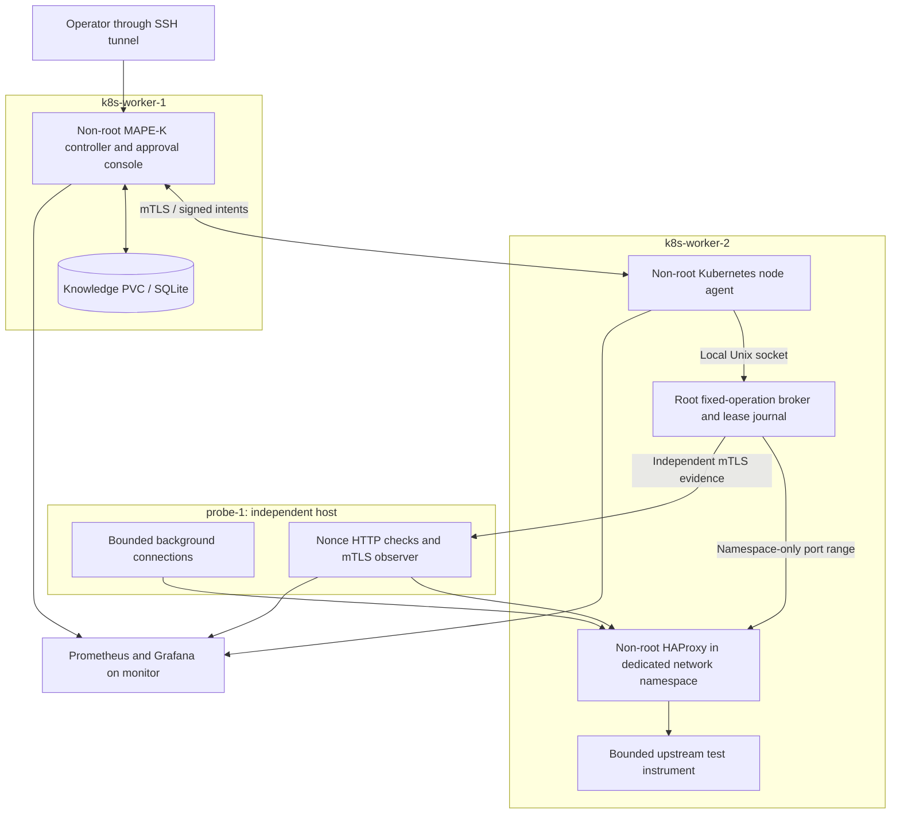

# Implemented gateway architecture

The single use case is recovery of a real HAProxy gateway suffering outgoing local-port exhaustion during bounded connection pressure. See the detailed [gateway design](gateway-design.md) for identity, admission and evidence contracts. A bank's traffic peak motivates this infrastructure problem; the project does not simulate a banking application or claim DORA certification.

## Runtime map

Six VMs have distinct roles: bastion .205 for administration/private archives; monitor .50; protected K3s server .80 using SQLite; worker-1 .81 for controller/build; worker-2 .82 for gateway/broker/agent; probe-1 .84 for independent checks and bounded load. No obsolete banking or nginx application is required.

HAProxy runs as user haproxy with no capabilities, one thread, maxconn 128, MemoryMax 192 MiB and CPUQuota 30%. Its namespace has a veth pair and an exact probe route, no default/Internet route, and a dedicated forwarding filter restricted to the probe. The backend is loopback-only. This is a real gateway with an intentionally synthetic upstream, not a production banking deployment.

## MAPE-K stages

| Stage | Implemented responsibility |
|---|---|
| Monitor | Kernel namespace pool occupancy/allocation errno; HAProxy backend error deltas and HTTP outcomes; separate upstream health; host memory headroom; independent fresh client nonce transactions |
| Analyse | Two consecutive correlated exhaustion observations; distinguish dependency, reserved-port conflict, unsafe headroom, missing/stale evidence and unrelated HTTP failure |
| Plan | Only the configured namespace range, baseline 40000-40031 to approved 40000-40255; bounded lease, expected identity/value, verifier and rollback |
| Execute | Mode gate and named approval or validated scoped procedure; mTLS controller identity plus HMAC-signed bounded intent; root policy/fresh admission/journal-before-write |
| Knowledge | Incidents, before/after evidence, decisions, operation IDs, mode changes and procedure scope; two distinct verified occurrences and explicit promotion permit reuse |

Verification requires three distinct independent observations spanning at least two seconds, with healthy gateway and upstream, within a bounded deadline. Re-reading the same observer sample cannot count again. A successful sysctl write is not recovery. The broker restores baseline on lease expiry only after backend connections drain and only if the value still matches its applied setting. An administrator change becomes a conflict, not an overwritten value. Root cooldown prevents rapid reapplication even if the controller is bypassed.

Identity includes boot, namespace inode, root registry/policy, HAProxy PID/start time, executable/configuration hashes and cgroup. Replacement/reconfiguration changes scope and requires requalification. Missing evidence is unknown, never healthy. Failed verification suspends automatic reuse. Idle recovery resolves unused approvals rather than leaving a stale repair executable.

## Trust, transport and availability

Controller and agent run non-root with read-only images, all capabilities dropped and no Kubernetes API token. The agent's one hostPath exposes the broker socket directory; this is an explicit Pod Security exception. The broker runs natively with a root-owned policy and no Internet listener. Its substantial privileges are documented in [security](security.md).

Agent and observer APIs require private-CA mTLS. Monitor certificates are read-only; only the controller TLS identity can submit signed effects. The controller UI is accessible through an authenticated SSH tunnel and a private operator session. Node-exporter/Prometheus foundation traffic remains private HTTP; enterprise IAM and encryption of every telemetry hop are not implemented.

The broker journal/watchdog is independent of the controller; a controller outage does not remove lease expiry. Stopping the broker removes its watchdog until restart. One controller, one Knowledge PVC, a single K3s server and a single gateway remain availability dependencies. The project measures bounded recovery, not an HA banking platform.

## Retained regression work

The earlier loopback port and descriptor fixture implementations, tests and histories are retained as regression evidence. They are not enabled by the gateway policy and are not additional active demo services. The old bootstrap refuses to overwrite a gateway installation. Descriptor prlimit has a PID-based syscall race and is not offered for arbitrary production processes. I/O priority provided no consistent benefit in the bounded exploratory comparison, so automatic I/O repair remains disabled.
