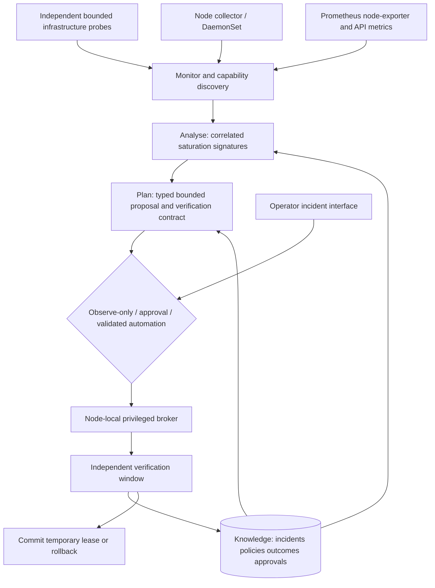

# Autonomous Kernel & Platform Tuning Engine — architecture specification

Design baseline: 17 October 2026. The initial specification was delivered before implementation; this repository copy now records the implemented layout and remaining qualification work. The previous bank-statement workload is being retired; its measurements do not validate this platform engine.

## 1. Business scenario and exact engineering objective

A bank's high-volume retail event creates connection churn and competing storage activity around its gateways and Kubernetes platform. The patient is the Linux networking/resource layer and the Kubernetes control plane, not a banking application. Success means a measured infrastructure service resumes useful connections/operations after a bounded runtime resource adjustment, with the same protected process identity, a recorded explanation and verified rollback.

50,000 requests/second is the motivating scenario, not an EduCloud capacity claim or experiment requirement. Start with small, bounded loads that produce the same failure signature. Report attempted/failed/successful connections and latency; never promise zero drops, full production readiness or universal Kubernetes compatibility from this lab.

Technical corrections:

- An inbound listener does not allocate a new ephemeral local port for every accepted connection. Relevant exhaustion occurs on outbound gateway connections, explicit source binding or NAT/conntrack paths; these need different telemetry and repairs. TIME_WAIT totals alone do not prove port exhaustion.
- Enlarging an existing process's soft descriptor limit is useful only when the hard ceiling and application behaviour permit it. It does not resolve leaked descriptors or application-internal worker limits.
- I/O priority is not extra disk capacity. Scheduler/device support and the competing workload matter. Prefer reducing an explicitly lower-priority competitor over granting a critical process real-time priority. Unsupported actions are refused.
- Single-server K3s normally uses SQLite. Discover the live datastore; etcd-only metrics must be marked unsupported when etcd is absent. Do not migrate the control-plane datastore merely to make a demonstration fit.
- Kubernetes node reconciliation does not imply an aggressive cloud autoscaler is running. Inventory actual controllers; do not invent a cascading autoscaling event.

## 2. Target metrics and diagnostic contracts

| Domain | Measurements | Evidence required before a plan |
|---|---|---|
| Outbound TCP capacity | Effective network namespace; ip_local_port_range and reserved ports; unique allocated local ports by local address/protocol/destination; established/TIME_WAIT counts; connect error codes and success/latency | Correlated allocation failures such as EADDRNOTAVAIL, high measured pool occupancy and approved namespace identity. TIME_WAIT or a high connection count alone is insufficient |
| Backlog / ingress pressure | ListenOverflows, ListenDrops, SYN queue counters, retransmit deltas and connection attempts | Distinguish backlog saturation from outgoing port or packet-tracking saturation; initial release diagnoses only unless a separately validated capability exists |
| Descriptor capacity | Pinned PID/start time/executable/cgroup; /proc/PID/fd count; soft/hard RLIMIT_NOFILE; process EMFILE evidence; host file-nr/file-max | Sustained near-soft-limit usage plus observed allocation failures and host memory headroom; distinguish per-process EMFILE from host ENFILE |
| I/O contention | Host and cgroup io.pressure some/full; disk read/write time and operation rates; in-flight I/O; device scheduler; cgroup io.stat; probe fsync latency | Correlation across pressure, device and durable-operation latency; identify an explicitly managed lower-priority workload and supported scheduling/controller capability |
| Control plane | API readiness/latency/error ratios, watch/list latency, node heartbeat freshness, discovered datastore | For etcd, collect WAL fsync/backend commit histograms and leader/quorum health. For SQLite, report process/device evidence and API latency without pretending to have etcd metrics |
| Safety and collateral impact | CPU/memory pressure, OOM events, free disk, agent sample age, action duration, lease expiry, rollback status, audit export health | Reject absent/stale/invalid samples, identity changes, unsupported kernels, conflict with another owner or pre-existing unsafe baseline |

Prometheus/node-exporter supply common host trends. A narrow node collector supplies namespace- and process-specific evidence they do not provide. Counter changes use monotonic sampling with reset detection. Histograms need enough observations before quantiles are interpreted. A missing metric means unknown/unsupported, never zero pressure.

## 3. MAPE-K architecture



Three deployable responsibilities are sufficient; do not split five conceptual stages into five fragile microservices:

1. **Node agent DaemonSet:** unprivileged collector and status publisher; no shell execution, cloud keys, arbitrary host file access or autonomous privilege escalation. Bounded local samples continue if the control plane is slow.
2. **Controller Deployment:** one active leader, MAPE-K analysis/planning, incident/approval API and durable Knowledge. It reconciles typed policies and action status. It does not need cluster-admin, node deletion, workload restart or CloudStack credentials.
3. **Node-local execution broker:** a small root-owned host service with a fixed Unix-socket protocol. It owns the mutation journal, target identity checks and lease rollback. Host bootstrap is separate IaC. This avoids a blanket privileged container with a writable host root mount. An optional direct privileged DaemonSet is not the default or an advertised enterprise-safe shortcut.

A controller outage cannot leave unlimited permission on a node. The broker accepts only bounded, expiring, node-bound plans allowed by a root-owned policy. Unknown signatures remain incidents. A degraded controller may allow a previously validated, explicitly pre-authorised local action only if its local evidence and lease conditions still hold. No new policy, approval or learner promotion happens without the controller.

Knowledge uses transactions and schema versioning. Record baseline, evidence, action/plugin versions, kernel/runtime/scheduler/namespace/process identity, before/after values, verification outcome and operator decisions. Two distinct verified incidents plus explicit promotion enable narrowly scoped reuse. Failed verification suspends the procedure. A proposal's successful syscall is not successful healing. A workload/schema/plugin change invalidates the matching procedure.

An LLM is unnecessary for this engine's authority and is excluded from the execution path. If later used to explain evidence, it remains optional, receives a sanitised projection and cannot create new capabilities. The core remains free/open-source and works offline.

## 4. Privilege and trust model

| Component / operation | Required authority and boundary |
|---|---|
| Controller | Dedicated service account; read nodes and approved monitoring objects, own namespace ConfigMaps/Leases/events or explicit CRDs; no Secrets listing, pods/exec, node/pod delete or general workload patch |
| Agent | Non-root, read-only image, drop all capabilities, no hostPID/hostNetwork by default; only the root-owned broker socket directory mounted. PSA hostPath exception is explicit and confined; an unprivileged container does not make its broker permission harmless |
| Broker baseline | Root-owned systemd unit, private Unix socket, validated peer credentials and fixed protocol, bounded messages/timeouts, root-owned target policy, no command/path interpolation from clients; separate audit/state directories; no Internet listener |
| Host network sysctl | Root/native host network context and NET_ADMIN where the particular kernel permits; validate actual mount permissions and namespace. Pod securityContext.sysctls is not a mechanism for changing host net.* settings with host networking |
| Other network namespace | Namespace entry requires SYS_ADMIN in the relevant user namespace. The lab harness may use this on a positively identified, dedicated disposable namespace. It is not enabled as a general production broker capability |
| prlimit | SYS_RESOURCE for other process identities/hard-limit changes, or matching permitted UID/GID semantics. First release only raises a soft limit within an approved fixed hard ceiling, never alters a ceiling automatically, and checks PID plus start time/executable; a narrow PID-based syscall race remains and restricts this release to bounded owned fixtures (see security.md) |
| I/O scheduling | SYS_NICE or documented ownership permissions as appropriate; check scheduler, kernel and cgroup support. Refuse realtime scheduling; do not use ionice -t to hide failure. A recorded scheduling value is not evidence the device honoured it |

Capabilities do not override a read-only proc mount or make privileged operations portable. SELinux/OpenShift SCC restrictions and managed-cluster node access are explicit deployment gates. Unsupported distributions run observe-only. “Any cluster” is an adapter goal, not a compatibility claim.

The broker rechecks identity and expected old value immediately before mutation. It writes an intent journal before changing state, reads the actual resulting value, and stores a rollback lease. Rollback is compare-and-set: restore only if the current value still matches the engine's applied value. If an administrator changed it, record a conflict and escalate rather than overwriting the administrator. On restart reconcile unfinished operations; never blindly repeat an unjournalled change. Lock per target and cap action rate/duration and total exposure.

Do not lower a process's soft limit below its current open-descriptor usage during rollback. A resource cleanup/lease expiry may need a deferred rollback with an incident; do not claim every runtime adjustment is instantly reversible. Sandbox expiry cleans only explicitly owned load processes and namespaces, never a bank process.

## 5. Initial plugin support and execution gates

- **Port-range capacity:** first prove inside a dedicated namespace using an outbound TCP fixture, fixed destinations and a deliberately bounded range. Preserve the reserved set and avoid NodePort/service/ephemeral-policy collisions. Increasing the range is a typed capability. tcp_tw_reuse and obsolete tcp_tw_recycle are not automatic repairs.
- **Descriptor headroom:** a dedicated infrastructure connection fixture emits EMFILE and descriptor telemetry. Raise only its reviewed soft ceiling within its preconfigured hard ceiling, verify useful new connections on the same PID, and verify rollback after draining the test load.
- **I/O contention:** begin with capability discovery and evidence. On a supported target test a separately owned low-priority competitor with strict size/time limits, then measure fsync/API latency with and without the action. If ionice has no measurable effect on this virtual disk/scheduler, report unsupported/no benefit; do not present configuration readback as recovered etcd.
- Host-wide production changes, control-plane storage mutations and cluster autoscaling remain observe-only/approval-only until their own capability tests and evidence exist. No VM reboot, Pod restart, node replacement or data-store rewriting is in this catalogue.

## 6. Repository layout

```text
README.md, AGENTS.md, LICENSE, pyproject.toml, Dockerfile
src/platform_healer/
  model.py              # samples and signed intents
  analyse.py            # correlated signatures and unknown outcomes
  engine.py             # serial MAPE-K transitions and reconciliation
  knowledge.py          # incidents, reviewed procedures and audit
  leases.py             # journal-before-write and rollback watchdog
  broker.py             # root Unix-socket fixed-operation service
  host_helper.py        # isolated namespace operations
  fixtures.py           # bounded infrastructure load fixtures
  transport.py          # size/time-bounded client transports
  agent.py              # non-root DaemonSet proxy and metrics
  controller.py         # non-root controller, operator API/UI and metrics
  plugins/base.py, plugins/linux.py
config/educloud.json     # public node inventory, pinned base image, key paths
manifests/render.py      # secret-free native Kubernetes objects
host/
  bootstrap-canary.sh
  platform-console-tunnel.service
monitoring/
  build.py
  prometheus.json, blackbox.json, rules.json, dashboard.json
experiments/
  canary.py             # local fixed-operation mechanism proof
  native_workflow.py    # actual Kubernetes operator-API proof
  io_capability.py      # bounded exploratory priority comparison
  acceptance.py         # live dashboard, privilege and baseline checks
scripts/
  deploy_lab.py, configure_monitor.py, backup_state.py
tests/test_core.py, tests/test_engine.py
docs/architecture.md, docs/security.md, docs/research.md
  docs/install.md, docs/demo.md
evidence/validation.md  # numeric/public acceptance record only
.github/workflows/tests.yml
```

Plugin registration is reviewed code plus a declared schema: telemetry requirements, supported environments, immutable target identity, parameter bounds, approval class, verifier and rollback logic. Configuration cannot introduce executable commands. Build images from pinned dependencies and publish checksums/SBOM; reproducible source deployment is a prerequisite for claiming release support, not something inferred from GitOps YAML.

## 7. EduCloud migration and removal plan

Keep only platform dependencies: management/bastion for access and off-platform evidence, independent monitoring, the existing K3s control/worker nodes and an independent load/probe host. Inspect actual capabilities before choosing a canary node. No 50,000-RPS storm or disk stress on the sole control-plane/root disk.

1. Inventory project-scoped VM IDs, volumes, addresses, active controllers, Kubernetes namespaces, metrics and datastore. Preserve the existing banking release and its private state/keys/results on the laptop; retain its Git history but remove it from the active project.
2. Prepare a separate platform branch/release and tests. Stop/disable the banking loop and console before platform actions; never run competing controllers.
3. Deploy platform observe-only collector and broker canary, then run the isolated networking and descriptor experiments with watchdog cleanup. Independent monitoring must remain reachable throughout.
4. Replace the old dashboard/interface with platform incidents, evidence, action/rollback status and procedure scope. Do not carry banking claims or old green results forward.
5. Remove the bank Kubernetes namespace only after identifying and archiving its persistent data/secrets. Remove old bank scrape jobs and services. Delete unneeded db-1, old app-1/app-2 and their specifically inventoried associated resources only after replacement acceptance and recovery archives verify. Deletion uses exact project/ID allowlists; no broad delete/expunge sweep. Re-inventory to prove no orphaned resources or necessary gateways were removed.
6. Publish reviewed source/configuration and numeric summaries to a new PR; raw histories and private backup material stay on the laptop. Close/supersede the unmerged banking PR when the replacement is concrete.

## 8. Evaluation, standards and release criteria

For each supported signature, compare equal bounded loads under observe-only and enabled operation, with the same baseline, caps, timing and repeated runs. Measure diagnosis correctness, failed/successful connections, latency distributions, time to verified recovery, collateral pressure, no process restarts, before/after settings, rollback and refusal of unrelated targets. Include wrong diagnosis, missing/stale samples, counter resets, PID/namespace replacement, conflicting administrators, exhausted host capacity, failed mutation and controller/broker crash tests.

Keep repeated failure reuse distinct from general prediction, reinforcement learning or arbitrary remediation synthesis. No stock Kubernetes recovery is counted as this engine's repair. A scheduler with no treatment effect is an experimental result, not a reason to alter the test until it looks green.

MAPE-K is the control architecture. DORA informs documented ICT risk/change control, incident evidence, recovery, learning and resilience testing; it does not certify an open-source tuning daemon. Governance, independent approval, institutional risk classification, reporting, third-party contracts and operational assurance remain deployment responsibilities. A PoC cannot establish full DORA compliance or production readiness.

## Primary sources and research interpretation

- Linux IP sysctl reference: https://www.kernel.org/doc/html/latest/networking/ip-sysctl.html — port allocation/reservations and socket reuse cautions.
- Kubernetes sysctl scope: https://kubernetes.io/docs/tasks/administer-cluster/sysctl-cluster/ — pod versus host namespace restrictions.
- Kernel PSI: https://www.kernel.org/doc/html/latest/accounting/psi.html — host and cgroup pressure semantics.
- K3s datastore: https://docs.k3s.io/datastore — discover SQLite/etcd rather than assume.
- etcd metrics: https://etcd.io/docs/v3.6/metrics/ — datastore latency evidence when applicable.
- Linux prlimit: https://man7.org/linux/man-pages/man2/prlimit.2.html — target identity and capability semantics.
- Linux I/O priority: https://man7.org/linux/man-pages/man2/ioprio_set.2.html — permissions and scheduling limitations.
- Kubernetes Pod Security: https://kubernetes.io/docs/concepts/security/pod-security-standards/ — explicit host-access exceptions.
- DNB DORA: https://www.dnb.nl/voor-de-sector/open-boek-toezicht/wet-regelgeving/dora/ — regulatory context, not a software certification.

Sources accessed 17 October 2026. Design decisions above are engineering interpretation. Actual support and measured outcomes must be recorded separately after implementation and live tests.


## 10. Implementation boundary after the first live validation

Implemented: two owned fixture plugins; 36 offline checks; root journal/leases;
unprivileged native DaemonSet and single controller; durable incidents and
reviewed scoped learning; approval/promotion/suspension UI; platform metrics,
alerts and dashboard; private consistent recovery backups; standalone
administrator deployment independent of the retired banking code.

The local broker workflow and the native controller workflow each passed two
reviewed descriptor occurrences, explicit promotion, a third automatic occurrence,
and an outbound-port recovery with unchanged process identity and baseline
restoration. These are mechanism/acceptance tests, not a statistically powered
comparison or proof of production performance. The independent I/O comparison
found no consistent priority benefit, so no I/O mutation plugin is enabled.

The idle fixtures can persist to preserve process identity, but each load burst
has a 120-second watchdog and a 128-resource cap. One-shot fixtures also enforce
an overall 10–900-second lifetime. Current correlation uses fresh paired counter
observations; sustained-window/hysteresis control, comprehensive headroom
admission, schema migration, production target discovery/cgroups, response
attestation, per-node key rotation, mTLS, HA/SBOM and OKD qualification remain
release work. Earlier sections describe the design goals where these exceed
this initial implementation; they are not delivered capability claims.
