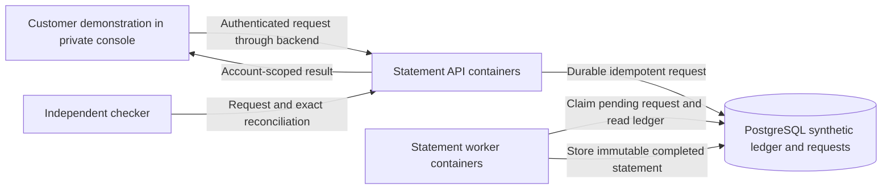
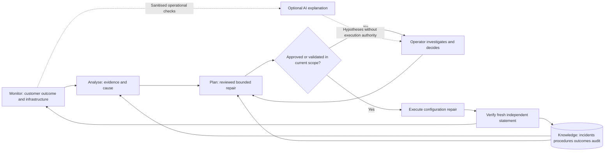

# Architecture: one banking service and its MAPE-K manager

## Customer request path

The API and workers run in Kubernetes. The ledger and requests remain on a separate database VM. The console backend holds the demonstration credential; browser responses do not expose it. API TLS and PostgreSQL TLS validate the private CA and endpoint identity. An internal metrics/readiness listener never serves financial endpoints.

## MAPE-K control path

`tools/jobs_service.py` runs the loop; `mapek/jobs.py` is the banking managed-element adapter. `mapek/loop.py` and `stages.py` implement control stages. `JobsOperator` and the shared investigation store enforce fixed recipes, current scope, approval and learning. The console reads completed-tick snapshots and invokes typed operator actions; it does not run a second loop.

| VM | Responsibility |
|---|---|
| healer-ubuntu | Controller, private console, incident and procedure SQLite stores |
| monitor | Prometheus, Grafana and blackbox checks |
| k8s-control | K3s control plane and private statement entry point |
| k8s-worker-1 / k8s-worker-2 | API and worker containers, native scheduling/reconciliation |
| db-1 | PostgreSQL synthetic ledger, requests, completed statements and audit |
| probe-1 | Independent customer request, exact result and deadline checks |

These seven VMs support one application. Two old application VMs are stopped and excluded from current monitoring. VMs provide separate trust/failure boundaries for the controller, database and observer; containers provide repeatable application deployment and native Pod recovery. Kubernetes does not know whether an account statement is correct or whether the declared database endpoint is the reviewed one. The manager adds those application requirements.

## What is monitored

The observer measures completion time, authentication/transport failures, exact statement correctness and freshness. The controller correlates those results with API/worker readiness, reviewed endpoint, desired worker capacity, memory contract, database availability, worker nodes and network-policy behaviour. Required unknown or stale evidence cannot certify health. Prometheus also scrapes host CPU, RAM and disk, database queue/completion metrics, controller actions, incidents and observer outcomes. Grafana's single `selfheal-jobs` dashboard is the detailed view.

Knowledge is durable under `state/jobs`. Procedures are tied to service, resource identity, reviewed reference, adapter and recipe scope. Changed scope requires revalidation. A failed reuse loses eligibility. Operators can suspend a procedure without deleting its evidence. Database/network/compute repairs remain approval-only; the banking automatic catalogue contains the three configuration repairs.

The laptop reaches the private console and Grafana through VPN and pinned SSH tunnels. No public administrative or application exposure is required. Cloud credentials, bearer tokens, host keys, generated references, detailed histories and certificate keys are excluded from Git.

## Limits

A single database, controller and Kubernetes control node are not a production high-availability design. The browser console has single-operator password authentication, not enterprise SSO or independently enforced four-eyes approval. Private PKI renewal, credential renewal and backup scheduling are manual. Infrastructure repair does not repair a corrupt ledger. See [banking controls and gaps](dora-control-mapping.md).
