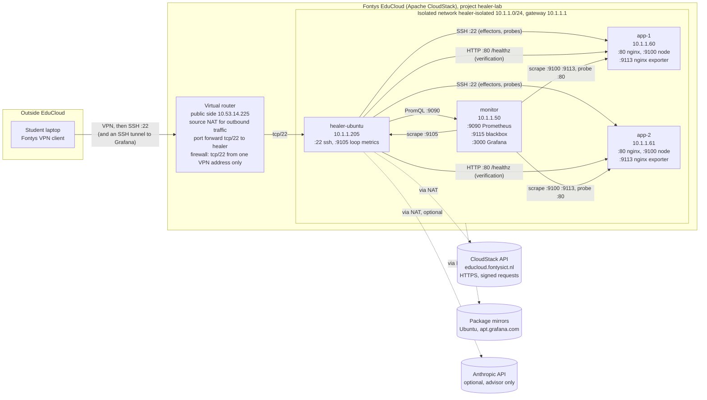
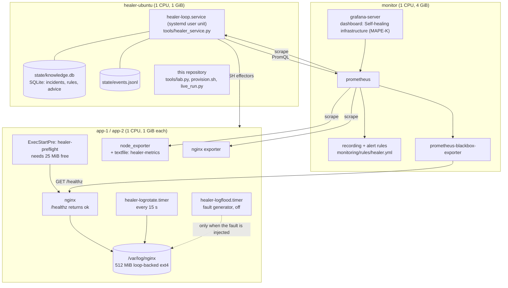
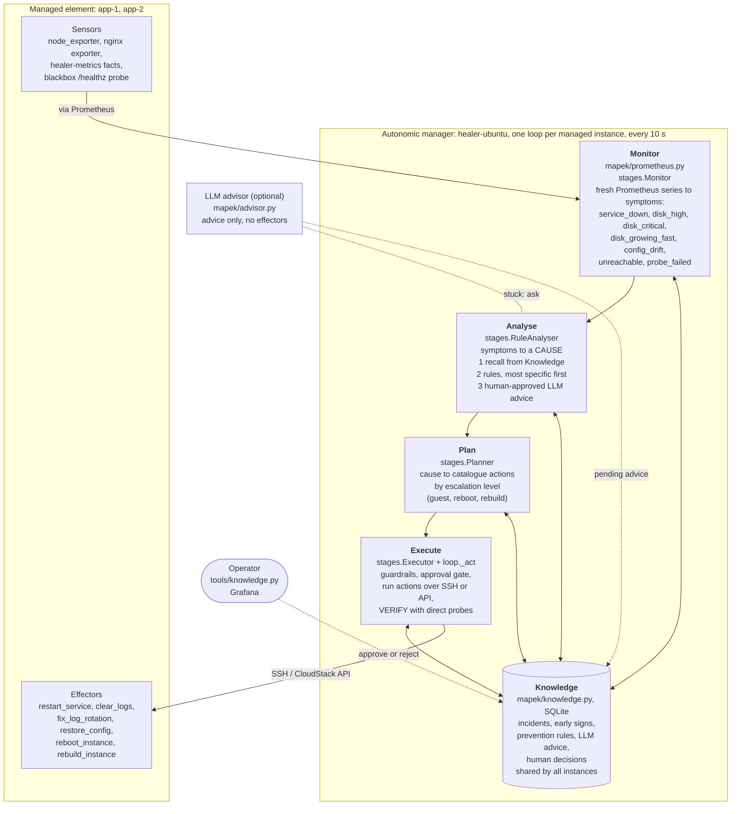
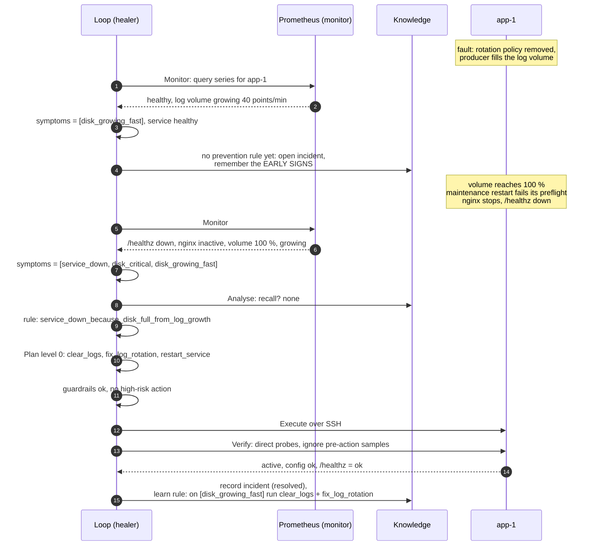
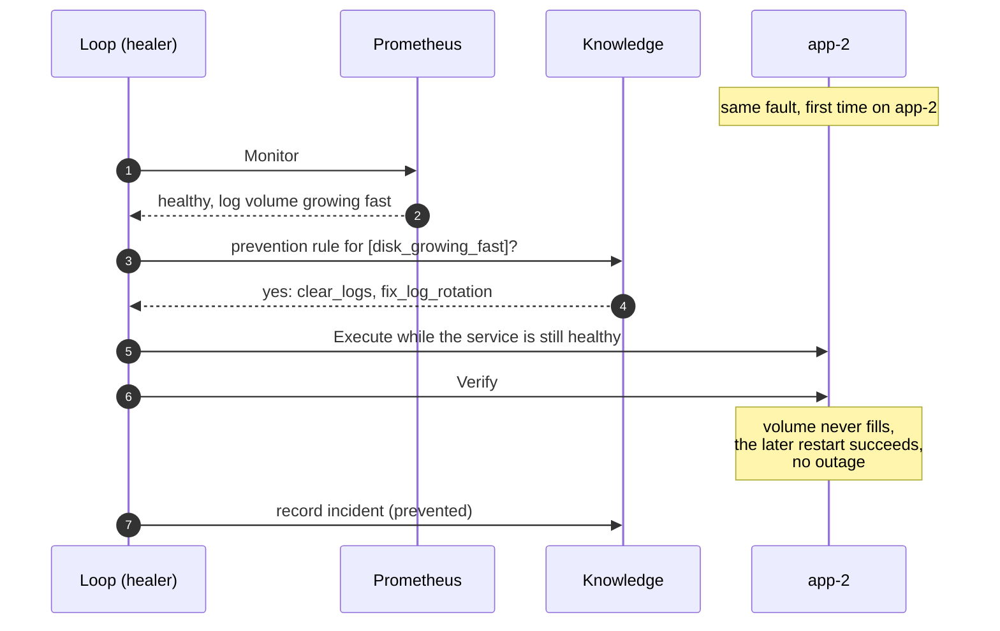
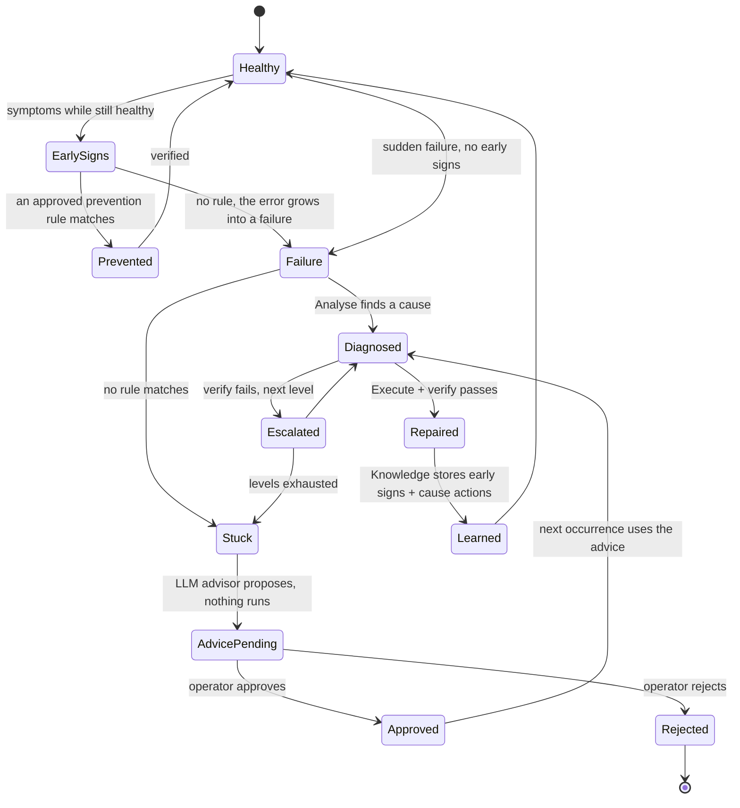
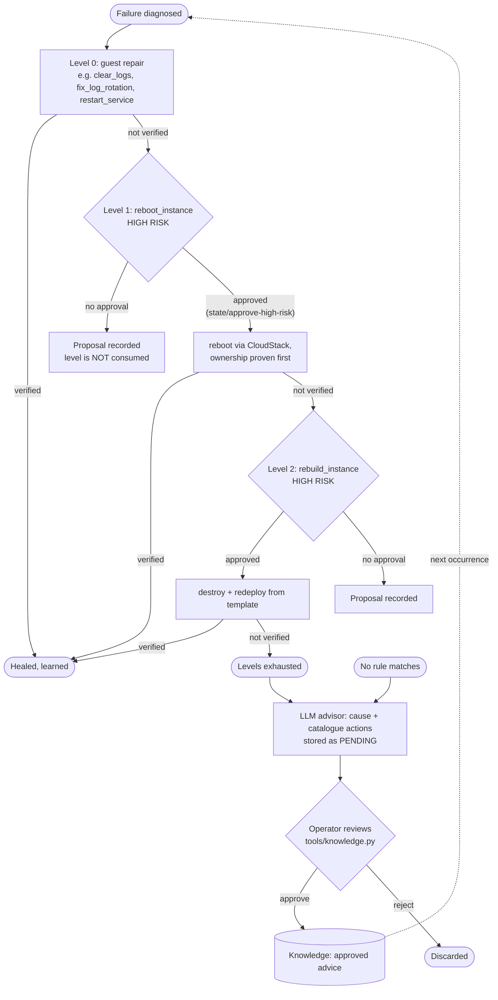
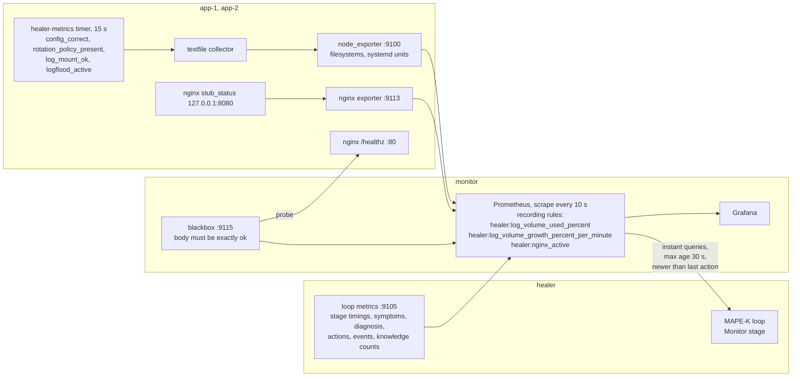
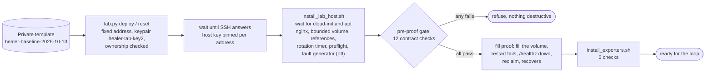

# Architecture and design

Diagrams render on GitHub (Mermaid). Every address, port and rule below was
read from the live EduCloud project on 2026-10-13, not copied from a plan.

1. [Network](#1-network)
2. [Deployment and services](#2-deployment-and-services)
3. [The MAPE-K loop](#3-the-mape-k-loop)
4. [One tick, step by step](#4-one-tick-step-by-step)
5. [How the loop learns](#5-how-the-loop-learns)
6. [Escalation and the human in the loop](#6-escalation-and-the-human-in-the-loop)
7. [Monitoring data flow](#7-monitoring-data-flow)
8. [Building and resetting an instance](#8-building-and-resetting-an-instance)
9. [Design approaches](#9-design-approaches)

## 1. Network

| From | To | Port | Purpose |
|---|---|---|---|
| Laptop (one VPN address) | healer | 22 | The only way in. Grafana through `ssh -L 3000:10.1.1.50:3000` |
| healer | app-1, app-2 | 22 | Guest effectors and direct probes, host keys pinned per address |
| healer | app-1, app-2 | 80 | Direct `/healthz` check after every repair |
| healer | monitor | 9090 | The Monitor stage queries Prometheus |
| monitor | app-1, app-2 | 9100, 9113, 80 | Host and nginx metrics, blackbox availability probe |
| monitor | healer | 9105 | The loop's own metrics |
| healer | CloudStack API | 443 | Instance state, ownership checks, reboot, rebuild, deploy |

Nothing in the lab is reachable from outside except SSH to the healer, and that
only from one VPN address. Fault injection and every probe stay inside
10.1.1.0/24.

## 2. Deployment and services

## 3. The MAPE-K loop

The reference model (Kephart and Chess, 2003), with what each part is in this
project.

| MAPE-K element | Concrete in this project |
|---|---|
| Managed element | nginx on app-1 and app-2, its config, its bounded log volume, the instance itself |
| Sensors | Prometheus exporters and the blackbox probe; direct SSH and HTTP probes as fallback and for verification |
| Effectors | Six named actions in `mapek/actions.py`. The loop cannot run anything else |
| Monitor | Prometheus queries per node, freshness checks, symptom naming |
| Analyse | Symptoms to cause: Knowledge, then rules, then approved advice |
| Plan | Cause to an ordered list of catalogue actions, by escalation level |
| Execute | Guardrails, approval gate, action, verification, record |
| Knowledge | Incident history, learned prevention rules, advice and human decisions |

## 4. One tick, step by step

The first time the disk fault happens (configuration C, empty Knowledge).

The next time, on any instance:

## 5. How the loop learns

Three kinds of memory, all in `state/knowledge.db`:

| Memory | Written when | Used by | Effect |
|---|---|---|---|
| Incident history | Every repair, success or failure | Analyse (recall) | A symptom set seen before is diagnosed from experience |
| Prevention rules | A resolved incident had early signs | The early-signs path | The cause is fixed before the failure happens |
| Approved advice | An operator approves LLM advice | Analyse (last resort) | An unknown failure becomes a known one after one human decision |

`Knowledge(auto_approve=False)` makes learned rules wait for a person too,
for settings where automation may not change its own behaviour unreviewed.

## 6. Escalation and the human in the loop

Guardrails apply to every executed plan: a cool-down per action (5 ticks) and
a rate limit (3 actions per 20 ticks). They exist because restart loops and
flapping are the classic way automation makes an outage worse.

## 7. Monitoring data flow

Freshness rules for the Monitor stage, each added after a live run showed the
problem:

- a sample older than 30 s is stale, never health
- after the loop acts, samples scraped before the action are ignored
- a rate over a one-minute window is only trusted once the whole window
  starts after the action
- a missing or stale field falls back to a direct SSH probe; if that also
  fails, the field is unknown and the instance is not healthy

## 8. Building and resetting an instance

Measured: a template rebuild until SSH answers takes about one minute, and
provisioning about 40 seconds. Exact figures per reset are in
`docs/results.md`.

## 9. Design approaches

Each decision, why it was made, and what was rejected.

| # | Decision | Why | Alternatives considered |
|---|---|---|---|
| 1 | **MAPE-K as the structure of the code**, one class per stage | The report and the code line up; each stage can be tested and shown on its own | A set of independent watchdog scripts (no shared knowledge, no place for learning); a Kubernetes operator (out of scope, and hides the loop) |
| 2 | **The managed element sits behind one interface** (`observe`, `health`, effectors) | The same loop runs against a simulation and against EduCloud | Writing the loop directly against SSH (untestable without a lab) |
| 3 | **A fixed action catalogue** | The set of possible effects is finite, reviewable and testable; the planner and the LLM can only name actions | Letting rules or an LLM produce shell commands (unbounded, unauditable) |
| 4 | **Repair the cause, not the symptom**, with a fault, error, failure chain | A restart alone brings the same failure back; fixing rotation removes it | Restart-only remediation, which most published systems stop at |
| 5 | **Verify after every action with direct probes**; health means every required probe readable and satisfied | An action that reports success while the service is down is the failure mode that makes automation dangerous | Trusting exit codes, or a unit reported "active" |
| 6 | **Learning as prevention rules from early signs** (case-based, "immune memory") | Explainable, works from one incident, every rule can be read and approved | Training an anomaly model (needs far more incidents than a lab produces, and cannot explain itself) |
| 7 | **Knowledge shared across instances** | One incident protects the whole fleet: learned on app-1, prevented on app-2 | Per-instance memory |
| 8 | **Prometheus as the sensor layer**, with freshness rules and direct-probe fallback | Industry-standard monitoring, one source for the loop and for Grafana | SSH probes only (no history, no dashboards); alerts as the trigger (adds the alert's own delay) |
| 9 | **Guardrails and escalation**: cool-down, rate limit, levels, approval for reboot and rebuild | Prevents restart loops and flapping; a destructive action is always a human decision | Unlimited retries; automatic rebuilds |
| 10 | **Fail closed on safety**: allowlist, positive project ownership, healer and monitor protected | A typo or bad metadata must never destroy the wrong machine | Checking names only in the CLI |
| 11 | **LLM as advisor, not actor**: schema-constrained to the catalogue, stored as pending, human approval | Gives help on unknown failures without giving an LLM control of infrastructure | An autonomous LLM agent with shell tools (unsafe, untestable, not reproducible) |
| 12 | **Deterministic failure through a declared preflight**, triggered by a deliberate restart | Stock nginx keeps serving on a full disk; the lab must show a real outage, honestly labelled | Pretending a full disk stops nginx; killing the process directly (no cause to find) |
| 13 | **Experiment resets from the template**, not snapshot reverts | Each run starts from a known identity and disk; runs cannot contaminate each other | Snapshot revert (faster, but carries state between runs) |
| 14 | **Independent measurement**: the experimenter probes `/healthz` itself every second | The system under test does not grade itself | Using the loop's own downtime counter |
| 15 | **Credentials only in memory**: environment, systemd user manager; never in files | EduCloud keys give control over the whole project | An env file on disk; keys in the repository |
| 16 | **Everything rebuildable from the repository**: fixed addresses, idempotent installers, evidence committed | EduCloud gives no backups and removes projects after about six months | Hand-built servers |
