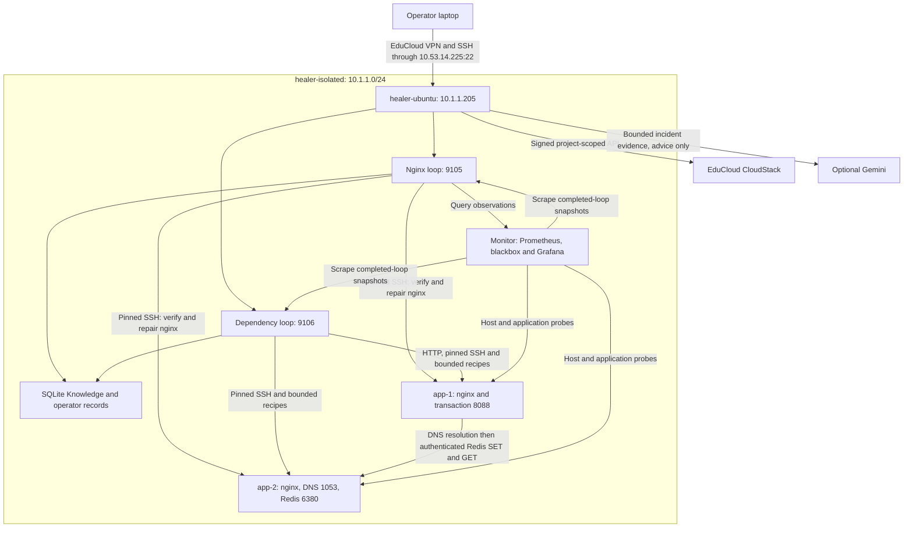
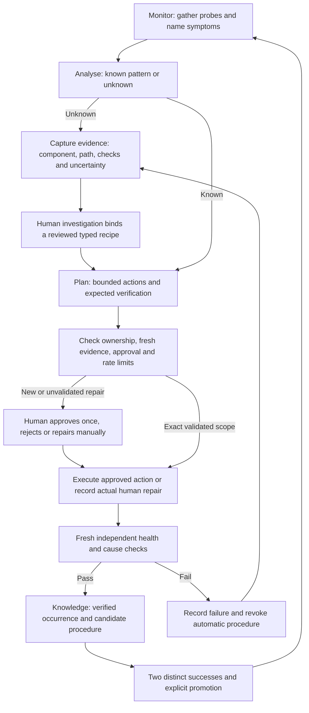

# Current architecture and behavior

## Machines and services

The lab contains four Ubuntu VMs on the EduCloud isolated network 10.1.1.0/24.
No application is a container. The workload is deliberately small and synthetic.

| Machine | Size | Services and responsibility |
|---|---|---|
| healer-ubuntu, 10.1.1.205 | 2 CPUs, 6 GiB RAM, 1 GiB swap | nginx MAPE-K loop, dependency MAPE-K loop, authenticated operator CLI, Knowledge and incident stores, optional Gemini advisor |
| app-1, 10.1.1.60 | 1 CPU, 1 GiB RAM | nginx on 80; transaction service on 8088; checkpoint file |
| app-2, 10.1.1.61 | 1 CPU, 1 GiB RAM | nginx on 80; dedicated dnsmasq on 1053; authenticated Redis on 6380 |
| monitor, 10.1.1.50 | 1 CPU, 4 GiB RAM | Prometheus 9090, blackbox exporter 9115, Grafana 3000 |

The laptop connects only to the healer. Use an SSH tunnel through it to view
Grafana. No app or monitor port is forwarded publicly. The SSH gateway firewall
is restricted to approved VPN addresses; check the portal when your address
changes. First SSH contact is trust on first use; an existing unexplained key
change fails. Console verification is required before changing a trusted pin.

## Two managed elements, one loop implementation

`mapek/loop.py` implements the shared orchestration; `stages.py` implements
monitoring, analysis, planning and execution. `guardrails.py` limits repeat
actions. Adapters provide observation, effects and independent verification.

- `EduCloudWorld` manages nginx on one allowlisted VM. The service creates one
  Healer per app, sharing a Knowledge database. Prometheus is normally the
  observation source; direct probes verify repairs and provide fallbacks.
- `InfrastructureWorld` manages the combined app-1/app-2 transaction. Its
  `InvestigatedAnalyser` uses an exact investigated pattern, not nginx rules.
  It reads dependency and systemd checks directly. Neither reboot nor rebuild
  is allowed for this composite because replacing one VM is not a whole-stack
  reset.
- `SimulatedWorld` supports offline development. Simulation findings are not
  proof of live nginx behavior.

## What is monitored

For nginx: reachability, systemd state, exact `/healthz` body `ok`, configuration
versus its reference, bounded log-volume usage and growth. Required probes must
be readable and true. A running service alone is not health.

For the infrastructure transaction: DNS must resolve `cache.lab.test` to app-2;
an authenticated Redis canary must accept SET and return GET; the transaction
must write and read `/var/lib/healer-stack/checkpoint`. Independent probes also
check transaction/cache unit state and Redis's approved 64 MiB budget. A failed
DNS check blocks cache measurement, rather than inventing a cache diagnosis.
An unreadable independent probe becomes a probe error and requires investigation.

The transaction is non-root and bounded. Its Redis user can only GET, SET and
PING the `healer:*` namespace. Credentials are generated on app VMs, never in
Git. The private network currently does not use TLS for DNS/Redis/HTTP.

## The MAPE-K workflow

Monitor runs approximately every ten seconds. Slow probes/repairs can lengthen
the actual cycle; this is not a hard real-time guarantee. Published metrics
represent the last completed tick and include timestamps so stale data can be
identified. Scraping does not wait for a repair to finish.

Analysis names a hypothesis and retains the evidence. It does not prove arbitrary
root causes. Planning chooses fixed nginx catalogue actions or reviewed typed
infrastructure recipes. Execution performs fresh ownership and evidence checks;
additional symptoms invalidate the earlier plan instead of widening approval.

## Repairs and learning

| Failure class | Cause-directed supported repair |
|---|---|
| nginx configuration drift | Restore reference, validate nginx configuration, reload or start |
| Bounded log-volume growth | Reclaim bounded logs and restore evaluated rotation policy |
| Stopped nginx | Start/restart the unit and verify the HTTP endpoint |
| Wrong dedicated DNS record | Restore its reference and restart dedicated DNS |
| Wrong cache memory budget | Restore effective Redis maxmemory to 64 MiB |
| Checkpoint permission drift | Restore exact owner/group and mode 0640, verify write and least privilege |
| Stopped dedicated cache | Start the cache and verify canary transaction |

Nginx has a **lab** startup requirement: below 25 MiB free on its 512 MiB
loop-backed log filesystem, ExecStartPre refuses to start. A deliberate restart
exposes this latent failure. Full logs do not by themselves stop stock nginx,
and a failed reload can leave nginx serving. The installer tests this mechanism.

Knowledge stores symptoms, diagnosis, actions and verified outcomes. The
operator database adds the exact VM/template/reference/recipe scope, approval,
investigation, human repairs and procedure status. The composite scope includes
both VM identities. Notes are never executable commands.

Two distinct verified repairs make a procedure eligible for promotion; a human
must explicitly promote it. Matching future cases can then use it automatically.
Changed resources, references, recipe book or failure pattern need revalidation.
Failed automatic verification revokes it and old successes cannot immediately
re-enable it. This is case-based procedural learning. It does not discover new
capabilities or train Gemini. Historical early-warning prevention exists in
Knowledge/simulation; reviewed production policy does not automatically grant
every learned prevention rule permission to act.

## Human control and LLM

The authenticated SSH CLI is the operator interface. `incidents.py` handles nginx
cases; `infrastructure.py` handles dependency investigation, approvals, recorded
human repairs and promotion. Grafana and HTTP status endpoints are read-only.
Rejecting a repair leaves it blocked. Approval expires and is single-use.
Reboot/rebuild require a separate high-risk gate in the nginx loop, remain
ineligible for automatic promotion, and cannot target the healer or monitor.

Gemini runs asynchronously when configured. It receives bounded observations
and incident evidence, suggests a hypothesis and checks, and records pending
advice. It has no SSH/API effectors. In the infrastructure workflow, approving
advice does not create an investigation binding or authorize execution. Human
review, bounded recipe selection and independent verification still apply.
The live exercises establish integration/workflow, not LLM diagnostic accuracy.

## Runtime state and evidence

Nginx uses `state/knowledge.db`, `state/operator.db` and `state/events.jsonl`.
Infrastructure uses separate equivalents under `state/infrastructure/` in its
active checkout. Shared host identity is under `~/.local/state/healer-lab/`;
each address has a pinned file under `~/.ssh/healer-lab-known-hosts/`.
The handover records active deployment paths and recovery steps.

Secrets and runtime state are ignored by Git. Historical evidence is retained
under `evidence/`; current offline checks and live smoke validation are separate
from historical A/B/C measurements. Templates provide clean Ubuntu, not the
complete current application stack. Reset requires installing all dependent
services and revalidating changed procedure scope.

See [the research synthesis](research-synthesis.md) for the four research
questions and evidence limits, and [the audit](repository-audit.md) for review
coverage. More fault classes, larger fleets and statistical effectiveness remain
research work; a four-VM prototype does not establish broad autonomy.
