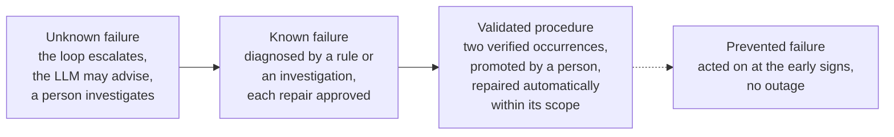

# Context report: what problem this solves

## 1. The real-world problem

Recurring operational failures include a disk that fills with logs, a configuration someone changed by hand, a
service that stopped and did not come back. Teams already know how to fix them,
so the cost is not knowledge but time and attention:

- someone has to notice, often outside working hours
- the quick fix is usually a restart, which treats the symptom, so the same
  incident returns days later
- what was learned lives in a ticket or in one person's head, not in the
  system
- automation that only restarts things can make an outage worse, by restarting
  in a loop or acting on a stale reading

Published systems already include learning and proactive mitigation. For example,
[Narya](https://www.usenix.org/conference/osdi20/presentation/levy) learns action
selection from measured outcomes. This project implements and evaluates a bounded
EduCloud prototype with reviewed procedural learning. It does not claim that
learning from failures is new. See [the research synthesis](research-synthesis.md).

**Objective.** Build infrastructure whose verified, explicitly promoted repairs
can act autonomously, while unfamiliar conditions need investigation:

1. detects a failure, localises the failing component and records evidence for a cause
2. repairs the cause, and proves the repair worked
3. remembers the incident, including the early signs that came before it
4. evaluates whether acting on an earlier signal can prevent recurrence within
   a validated scope, rather than assuming that faster recovery is prevention
5. asks for help, with a concrete suggestion, when it meets something it does
   not know, and learns supported repair procedures from independently verified
   human repairs and explicit promotion

The measure of success is **downtime**, measured from outside the system,
for the same fault: none (A), reactive healing (B), healing with learning (C).

## 2. The failure scenarios

The nginx scenarios below record the original experiment. The current extension
adds DNS, authenticated Redis, memory-budget and checkpoint-permissions failures;
see [broader infrastructure](infrastructure-lab.md). Original measurements are
preserved. Current approval policy differs from the historical A/B/C experiment.

Scope is the infrastructure layer: services, storage, configuration,
instances. Application bugs are out of scope.

Each scenario is written as fault, error, failure (Avizienis et al., 2004): the
fault is the cause, the error is the wrong internal state it produces, the
failure is what a user notices.

### Scenario 1: log growth fills the disk (the main experiment)

| | |
|---|---|
| Real-world version | A logrotate policy is lost in a package upgrade or a config management mistake, or debug logging is left on. The disk fills over hours or days. Nothing breaks until the next restart or deploy, which then fails, often at night and far from the cause |
| Fault | The rotation policy `/etc/logrotate.d/nginx-healer` is removed; a producer appends to the audit log |
| Error | The bounded 512 MiB log volume fills (to 100 % in about two minutes in the lab) |
| Failure | The next deliberate maintenance restart fails its startup storage preflight, nginx stops, `/healthz` stops answering |
| Detected by | Prometheus: log volume use and its growth rate, nginx unit state, blackbox `/healthz` |
| Symptoms | early: `disk_growing_fast`, later `disk_high`, `disk_critical`, then `service_down` |
| Cause found | `service_down_because_disk_full_from_log_growth` |
| Repair | `clear_logs`, `fix_log_rotation`, `restart_service`, then verify |
| Learned | On `disk_growing_fast`, run `clear_logs` and `fix_log_rotation` |
| After learning | Fixed while still healthy; the restart later succeeds; no outage |

This is the scenario that shows the difference between symptom and cause.
Restarting nginx treats the failure. Clearing the disk treats the error. Only
restoring rotation treats the fault. And because the failure is latent (the
service keeps running until the restart), it is exactly the kind of incident
that early-sign prevention can stop.

*Honest note:* stock nginx keeps serving on a full log disk. The lab declares a
startup storage requirement (an `ExecStartPre` preflight) so that the failure
is deterministic and observable. That is a lab protocol modelling a real
requirement, and it is reported as such.

### Scenario 2: configuration drift

| | |
|---|---|
| Real-world version | A hand-edit during an incident, or a bad deploy, leaves an invalid or unapproved config. The next reload or restart breaks the service |
| Fault | An invalid directive is appended to the live nginx config |
| Error | The live config differs from the reference and fails `nginx -t` |
| Failure | The next restart fails; the service is down |
| Detected by | `healer_config_correct` (textfile metric), direct `nginx -t` + diff |
| Repair | `restore_config` from the reference copy, validate, reload or restart |
| Live result | Restored 24 s after the change, before the scheduled restart, so users saw no outage |

### Scenario 3: the service stops

| | |
|---|---|
| Real-world version | An OOM kill, a crash, or a manual stop that is forgotten |
| Fault / failure | nginx is stopped; `/healthz` refuses connections |
| Repair | `restart_service`, verify |
| Live result | Healed 5.9 s after the stop, 5 s of measured downtime |

### Scenario 4: the instance is unreachable (escalation path)

| | |
|---|---|
| Real-world version | A kernel hang, a broken network config, a VM that stops answering |
| Repair | `reboot_instance`, then `rebuild_instance` from the clean template |
| Safety | Both are high risk. The loop records a proposal and waits for approval. It proves project ownership and never targets the healer or the monitor |
| Status | Implemented and unit-tested. Template rebuild is used live for experiment resets; the loop's own reboot and rebuild path has not been exercised live |

### Scenario 5: something no rule knows

| | |
|---|---|
| Real-world version | A new failure mode, or a combination of symptoms nobody wrote a rule for |
| Behaviour | The loop escalates and asks the LLM advisor. The advice (a cause and catalogue actions) is stored as pending. A person approves or rejects it. Approved advice becomes a diagnosis the next time the same symptoms appear; the repair it proposes still passes the incident review gate |
| Status | Implemented with Google Gemini (free tier) and tested with a stand-in provider. Real Gemini calls succeeded on 14 October 2026: one through `tools/demo_advice.py --real` against a simulated target, and four advisory responses on the dependency incidents. None of that advice was approved or executed, so there is no evidence yet of Gemini diagnosing a live failure correctly |

## 3. What the self-healing solves, and how autonomous it becomes

The system moves each failure up a ladder. Every step up removes a human from
the path.

| Stage of learning | Who acts | Outage | Where |
|---|---|---|---|
| Unknown | The loop asks; a person investigates and names a cause | Until a person acts | Both loops |
| Known (rule, approved advice or investigation) | The loop proposes; a person approves each repair | Until approval, then seconds | Both loops, with review on |
| Validated procedure | The loop, automatically, within the recorded scope | Seconds (detect, repair, verify) | Both loops, after promotion |
| Prevented (prevention rule) | The loop, before the failure | None | nginx loop, config C |

Between 13 and 14 October the policy changed. In the A/B/C experiment and the
first guided demo, known failures were repaired and prevention rules applied
without asking anyone. The live service now runs with incident review, so a
repair or a prevention action only runs on its own once a procedure covering
it has been promoted. A person is always needed for genuinely new failures and
for destructive actions, and reboot and rebuild never become automatic.

**Measured so far** (single live runs, each traceable under `evidence/runs/`):

| Run | Downtime measured from outside |
|---|---|
| Disk fault, config C, first occurrence on app-1 | 17 s, healed by the loop, rule learned |
| Same fault on app-2, never seen there before | **0 s**, prevented by the rule from app-1 (volume peaked at 15.6 %) |
| Disk fault, config A (no healing) | 180 s, the whole measurement window |
| Config drift, config C | 0 s, repaired before the restart |
| Service stopped, config C | 5 s |

The repeated A/B/C experiment (a fresh instance from the template for every
block) is in `docs/results.md`. Three repetitions were planned. Three were
completed for A and two for B and C: during rep 3 the healer ran out of memory
and the experiment stopped (`evidence/2026-10-13-incident-healer-memory.md`).

## 4. Was everything that was asked for used?

| Asked for | In the project | Where |
|---|---|---|
| Infrastructure first, on EduCloud | Four instances from a private template at fixed addresses, rebuildable from the repository | `tools/lab.py`, `tools/provision.sh`, installers |
| MAPE-K, followed strictly | One class per stage, the loop marked stage by stage, Knowledge shared, every stage visible in Grafana | `mapek/`, `docs/architecture.md` §3 |
| Prometheus and Grafana | Prometheus feeds the Monitor stage; Grafana shows every MAPE-K stage, symptoms, diagnosis, actions, learning | `monitoring/` |
| See how the self-healing works | Dashboard, `tools/knowledge.py events`, `state/events.jsonl`, the evidence folders | |
| It must learn from errors | Incident memory, prevention rules from early signs, approved advice; proven live (learned on app-1, prevented on app-2). Reviewed repair procedures promoted after two verified occurrences, demonstrated live for nginx config drift and four dependency faults | `mapek/knowledge.py`, `mapek/operator.py`, `mapek/infrastructure.py` |
| An LLM agent as human in the loop, e.g. LangChain | An LLM advisor using Google Gemini (free tier) over its REST API. Not LangChain: see below | `mapek/advisor.py` |

**Why Gemini, and why not LangChain.** Gemini's free tier costs nothing and
its quota is far more than a loop needs that only asks when it is stuck. Its
structured output (`responseSchema`) is what guarantees that advice can only
name catalogue actions. The call is plain HTTPS from the Python standard
library, so the healer needs no extra packages. LangChain is a framework for
chaining LLM calls and giving agents tools; here the LLM deliberately gets no
tools and makes one call, so a framework would add dependencies without adding
capability. The advisor sits behind a small provider interface, so another
model (or a LangChain chain, for a comparison in the report) can be swapped in
without touching the loop.

One point for the report: on the free tier, Google may use prompts to improve
its products. The prompt holds symptoms and lab metrics only, never
credentials or keys.

**Why an advisor and not an autonomous agent.** An agent that can run
commands on infrastructure cannot be tested exhaustively, behaves differently
between runs, and can be prompted by the very log lines it reads. For an
experiment that must be reproducible and a lab with real credentials, the
LLM's job is to shorten the human's diagnosis, not to replace the loop's
verified actions.

## 5. Mapping to the research questions

| Research question | What answers it |
|---|---|
| 1. Which failures can be self-healed? | Scenarios 1 to 3 healed live; scenario 4 implemented behind approval; scenario 5 needs a person; DNS drift, a wrong cache budget, checkpoint permissions and a stopped cache healed live in the dependency lab |
| 2. Which methods detect and repair most effectively? | Prometheus-based detection with freshness rules vs direct probes; cause-level repair vs restart; verification; the A/B comparison |
| 3. How can it learn to prevent failures? | Early-sign prevention rules, shared Knowledge, advice approved by people, reviewed procedures; the B/C comparison, the app-1 to app-2 transfer and the promoted dependency procedures. Faster repair of a recurrence is learned recovery, not prevention |
| 4. Effect on reliability, security, performance and scalability? | Reliability: measured downtime. Security: fail-closed ownership, pinned host keys, credentials in memory, no LLM effectors, incident review, and the host-key incident found during the project. Performance: stage timings on the dashboard (Monitor about 0.35 s per tick) and the dependency load sweep. Scalability: request capacity at concurrency 1, 4 and 8 on two VMs only, not more nodes |

## References

- Kephart, J. O. and Chess, D. M. (2003). The vision of autonomic computing.
  *IEEE Computer*, 36(1), 41-50.
- Avizienis, A., Laprie, J.-C., Randell, B. and Landwehr, C. (2004). Basic
  concepts and taxonomy of dependable and secure computing. *IEEE Transactions
  on Dependable and Secure Computing*, 1(1), 11-33.
