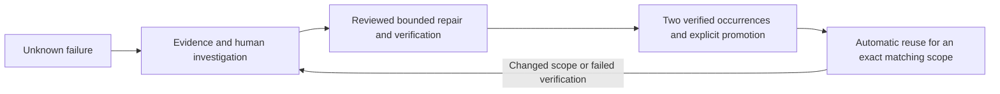

# Project context: investigated and verified self-healing

> Earlier nginx/dependency lab context. For the current Kubernetes job-service
> use case and console, start with [the current architecture](architecture.md)
> and [job deployment](jobs-deployment.md). Preserve the earlier evidence.

The project evaluates how an infrastructure manager can detect failures,
localise a failing component, propose a cause-directed repair, obtain human
review, verify recovery and reuse a validated procedure on recurrence.

A restart is one possible mitigation. It cannot restore a wrong DNS record,
cache budget or checkpoint permissions. The current prototype therefore manages
both nginx services and a synthetic infrastructure dependency transaction.
See [the architecture](architecture.md) for machines, services, diagrams and
the MAPE-K stages, and [the research synthesis](research-synthesis.md) for
primary literature, source-quality limits and the four research questions.

## Current scope and autonomy

Four Ubuntu VMs run ordinary systemd services, not containers. The healer
manages app-1 and app-2 inside an isolated EduCloud network. The monitor hosts
Prometheus and Grafana. Unknown failure patterns require investigation, a
reviewed recipe and approval. Recording a human repair only earns evidence
when independent probes certify it. Two distinct verified occurrences and
explicit promotion allow reuse within the recorded identity/reference scope.
Failed automatic verification revokes the procedure.

The system learns procedures, not arbitrary commands or model weights. Gemini
is an optional advisor: a real response is not proof of a correct diagnosis and
does not grant execution permission. A new failure can need more than one human
decision. No claim is made that every recurrence is prevented or every VM can
inherit another VM's approval.

## Measurements and report boundaries

The original nginx A/B/C results remain in [results](results.md), with raw
samples and failed runs preserved. They used an earlier policy. Their growth
prevention demonstration is distinct from current scoped procedure validation.
The bounded log-filling experiment uses an explicit startup preflight and a
deliberate restart; stock nginx does not stop merely because logs fill and can
retain its old configuration after a failed reload.

The newer dependency exercise records DNS drift, a wrong Redis budget,
checkpoint permission drift and a stopped cache. Twelve recoveries demonstrate
the scripted investigation/approval/manual-recording/promotion/reuse workflow.
They do not establish unrestricted root-cause accuracy or general LLM autonomy.
The retained concurrency sweep covers a single transaction on two VMs; it is
not fleet scalability or a production availability guarantee.

## Research questions and evidence

| Question | Project evidence and limits |
|---|---|
| Which infrastructure failures can be self-healed? | Observable failures with a permitted bounded effector, known desired state and trustworthy verification. Seven lab fault scenarios; other classes remain literature/future work. |
| Which methods are most effective? | Process and transaction checks, dependency evidence, exact invariants, cause repair and independent verification. A frontend restart comparator demonstrates its insufficiency for the four dependency faults; no universal method ranking is claimed. |
| How can learning prevent failures? | Verified scoped case reuse and revocation demonstrate learned recovery. Earlier nginx growth signals demonstrate bounded prevention; faster recovery alone is not prevention. |
| Effects on reliability, security, performance and scalability? | Measured downtime and failed requests, ownership/SSH/approval controls, resource caps and a small request-load sweep. Durable security, fleet scalability and broad reliability require further evaluation. |

Code, results and raw evidence must remain off-platform because EduCloud
availability, backup and project retention are not guaranteed. Public scans are
prohibited: all fault and security experiments stay within the isolated lab.
See [the runbook](healer-handover.md), [operator workflow](operator-workflow.md)
and [repository audit](repository-audit.md) before another live demonstration.
