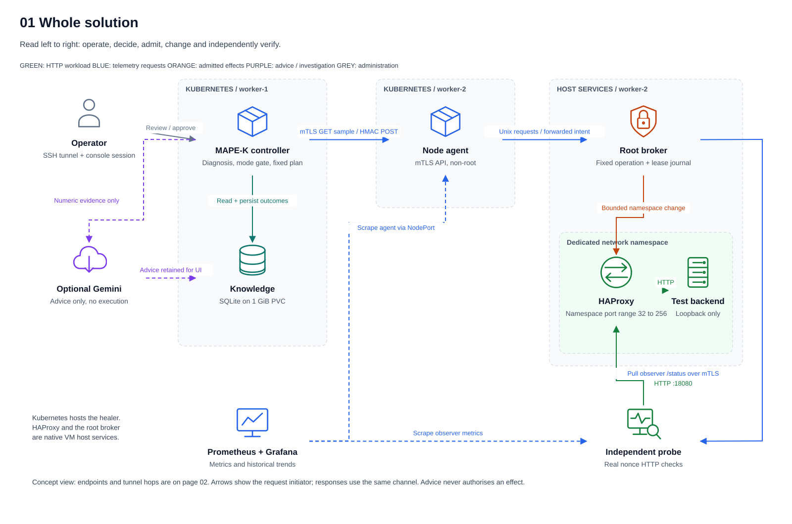
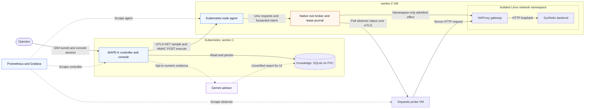
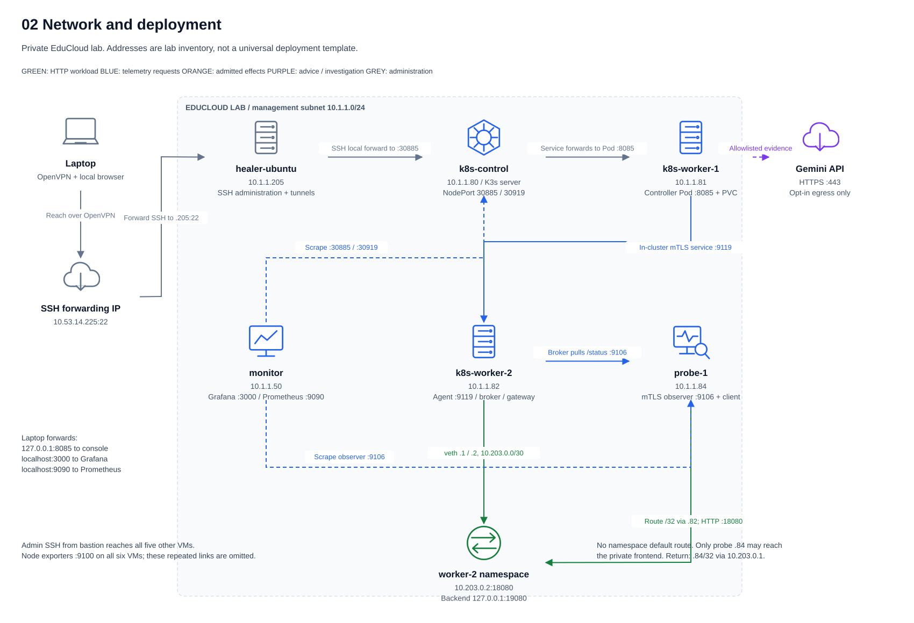
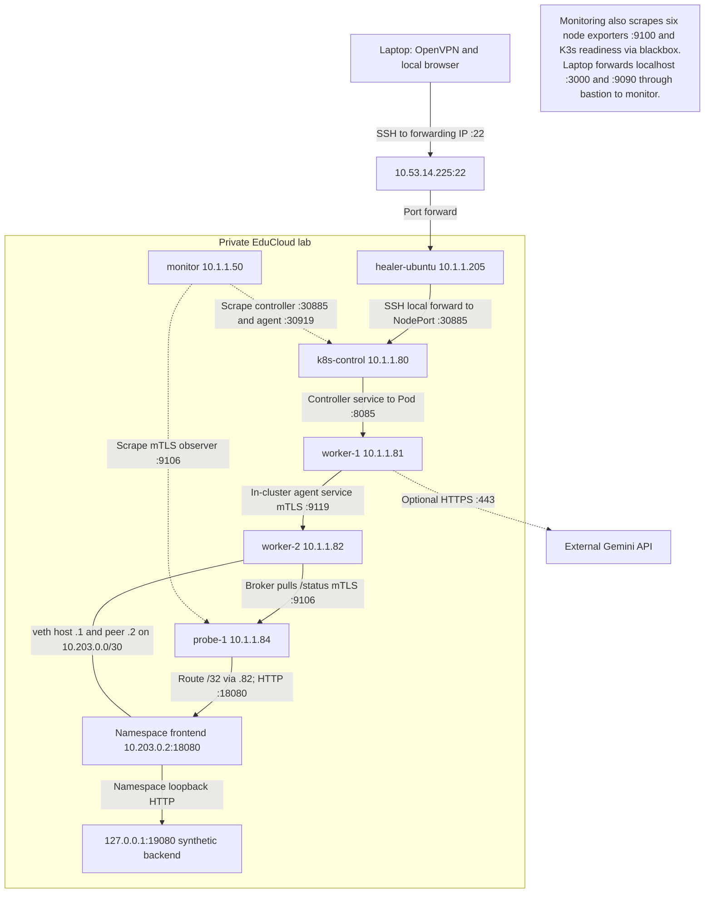
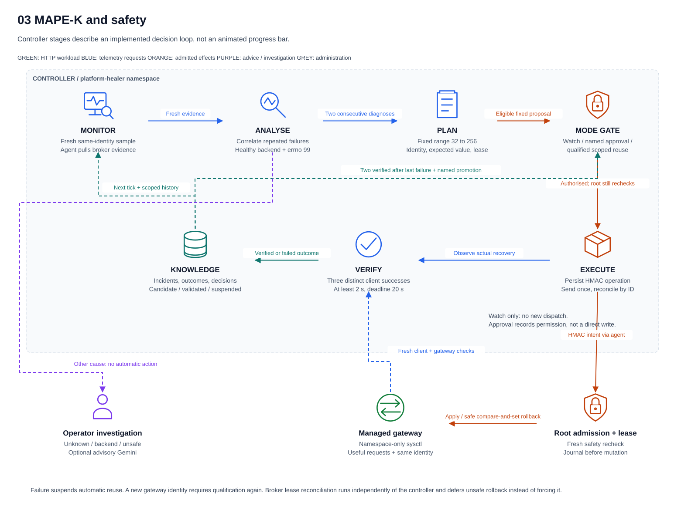
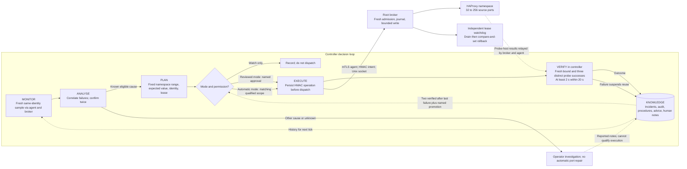
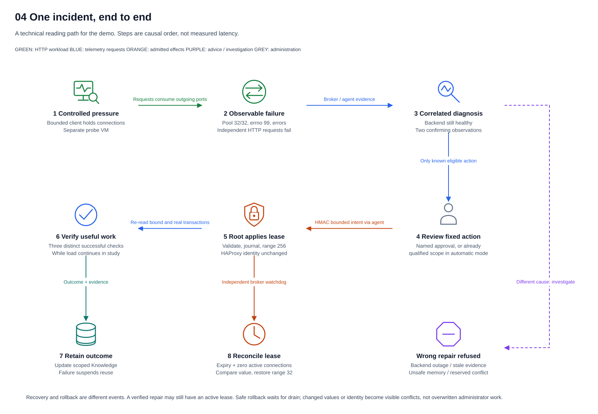
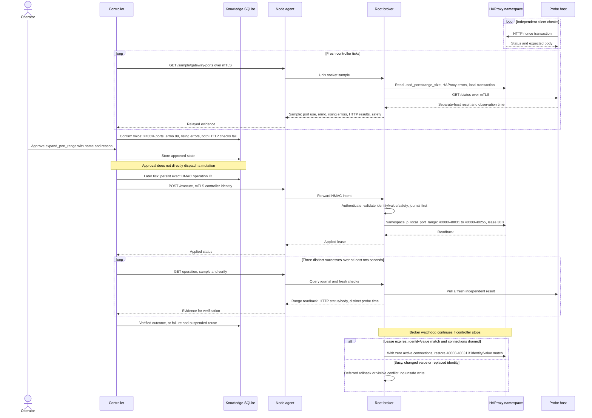

# Design diagram gallery

Start with [what breaks and exactly what changes](../worked-example.md), then the [design specification](../design.md). The existing [runtime architecture](../architecture.md#runtime-map) is retained.

Download [the four-page draw.io file](haproxy-system-design.drawio), open it in diagrams.net, and select a page at the bottom. Symbols are original generic vector icons, not official vendor logos. Labels, symbols, boundaries and connectors can be moved separately. SVG previews need no editor.

Arrows identify request initiators; replies use the same channel. The incident and MAPE-K views describe logical progression, not network transport or measured durations.

## Whole solution

[SVG](solution.svg) · [Mermaid source](solution.mmd)

## Network and deployment

[SVG](network.svg) · [Mermaid source](network.mmd)

## MAPE-K and safety

[SVG](mapek.svg) · [Mermaid source](mapek.mmd)

## One incident, end to end

[SVG](incident.svg) · [Mermaid source](incident.mmd)

## Maintain these views

Edit the Mermaid files for GitHub-rendered diagrams. Edit `scripts/build_design_diagrams.py` and run `python scripts/build_design_diagrams.py` to regenerate the SVG and draw.io views. The two formats express the same contracts with different layouts. Regeneration overwrites manual draw.io layout edits. Check both after changing an endpoint, identity boundary, approval rule or repair.
