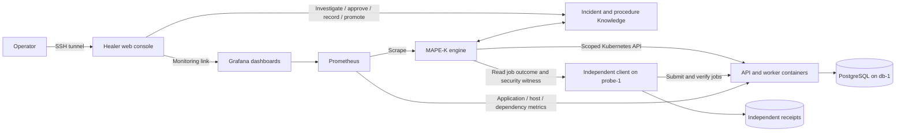

# One use case: recover a Kubernetes job-processing service

## Problem and user

A small IT operations team runs an asynchronous job service. A submitted job
must complete within 30 seconds and return the correct result. A running Pod
is not enough: a wrong database address, missing worker capacity or unsuitable
memory limit can stop useful work while Kubernetes continues running containers.
The lab uses deterministic SHA-256 jobs instead of customer data, so an
independent client can check both completion and correctness.

The research question is whether a MAPE-K controller, with operator investigation
and validated repair memory, can reduce recovery effort for recurring failures
that Kubernetes' built-in reconciliation does not resolve.

## Boundaries

One application, one namespace (`jobs-lab`), one operator and reviewed repairs.
Kubernetes manages Pod restarts and scheduling. The healer manages approved
application operating requirements and verifies a fresh job from another VM.
PostgreSQL stores jobs; the separate observer retains verification receipts.
Prometheus and Grafana show application, controller and infrastructure health.
The web console is the operator's explanation and approval interface.

The main experiments are wrong database configuration, worker capacity drift,
and worker memory configuration drift. Network-policy drift is a security
misuse case within the same application. Database and worker-VM recovery are
supporting capabilities, not separate research use cases. No public scans,
general intrusion remediation, arbitrary shell execution or database rollback.

## MAPE-K and learning

1. Monitor Kubernetes desired/actual state, dependencies and independent jobs.
2. Analyse symptoms, evidence and uncertainty. Unknown failures require an
   investigation; optional AI advice is an untrusted hypothesis.
3. Plan a reviewed, bounded procedure with cause-specific checks.
4. Execute only an approved current plan or an eligible validated procedure.
5. Store evidence, operator decisions and verification in Knowledge. Two
   distinct verified cases and explicit promotion enable reuse within the same
   resource, reference, adapter and recipe scope. Failed reuse revokes eligibility.

This is procedural learning, not LLM training or unrestricted code generation.
Recording a human's notes alone never proves a repair. Verification requires a
fresh independently submitted job and the repaired cause checks.

## Architecture

VMs provide the isolated cluster nodes, database, observer and management plane.
Containers provide the application workloads. These are complementary layers.
Kubernetes is chosen because its built-in self-healing supplies a useful baseline:
compare native Pod recovery against a persistent bad desired configuration that
requires an application-aware repair. A single-host Docker setup is simpler but
does not exercise worker scheduling and node separation; PLC and mobile-network
scenarios would require a different domain and validation setup.

## Evaluation and honest claims

Measure detection delay, recovery time, missed job deadlines, result integrity,
operator interventions, false diagnoses, failed repairs and controller overhead.
Compare native Kubernetes, operator-approved first repair and validated recurring
repair. Keep failed trials and distinguish pilot evidence from final runs.
Test stale approvals, changed resource identity, unknown probes, policy drift and
unexplained SSH keys as misuse cases. Store results off-platform.

The current deliverable is a research prototype with an extensible adapter
boundary. Supporting a new service requires its contract, probes, bounded repairs
and tests. Enterprise readiness, universal plug-and-play, multi-tenancy, high
availability and production security are not established by this lab.

## Retired work

The former nginx and DNS/Redis/checkpoint demonstrations are no longer active
or supported. Their two VMs are stopped; their dashboards, probes, installers
and launchers are retired. Evidence and source archives stay on the laptop.
Only the job-processing application is evaluated and presented in this release.
