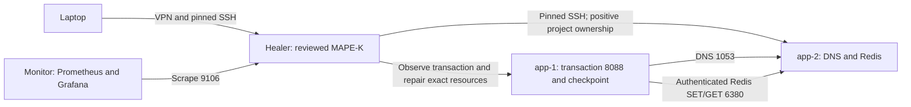

# Broader infrastructure and investigated learning

Read [the research synthesis](research-synthesis.md) for the four research
questions, source assessment and experiment limits. This lab adds infrastructure
dependencies to the earlier nginx experiment. These are Ubuntu VMs running
systemd services, not containers. The transaction is a synthetic test workload.



The client resolves `cache.lab.test`, writes and reads an expiring canary Redis
key, then writes and reads one small checkpoint. Redis has a 64 MiB data budget
and a 160 MiB systemd memory cap. The transaction has a 96 MiB cap; CPU and task
counts are also bounded. Its Redis account has no administrative commands.
Services and generated cache credentials are installed outside the repository.
No system DNS or public ports are changed. Platform rebuilds are refused by the
composite adapter because replacing one dependency is not a composite reset.

The state is `state/infrastructure/`, separate from nginx Knowledge and incidents.
Back it up, along with code and off-platform evidence. A replacement from the
baseline template needs the infrastructure installer again; the old template
does not already contain this stack. Run installation only on clean healthy
lab hosts; it restores their lab configurations and restarts these services.

## How the learning loop works

Monitor records transaction checks, systemd states and the effective cache
budget. Analyse initially names unfamiliar patterns `unknown`. A blocked cache
measurement after failed DNS is not a separate diagnosed cache failure. An
investigator compares the incident evidence with desired state, names the cause
and binds a recipe. Plan then proposes that recipe. Execute still requires
approval, ownership proof and existing cooldown/rate limits. Knowledge stores
independent verification, the repair scope and outcomes. Two distinct successes
plus explicit promotion enable automatic reuse for the same context.

`config/repair-recipes.json` defines reviewed compositions. Supported operations
restore the DNS reference, restore the approved cache budget, restore the exact
checkpoint permissions, and start the dedicated cache. A new composition needs
no Python stage changes. New kinds of operation still need a reviewed capability.
The schema rejects shell commands, arbitrary paths and missing cause checks.
Editing the recipe book or deployed reference identity invalidates prior scope.
`config/repair-recipe.example.json` illustrates a new two-operation composition.
It is not active. Validate it with `RecipeBook`, review it, add it to the book
and restart the loop before binding it to an investigated incident. A book change
requires scope revalidation; it does not silently inherit automatic approval.
This is reviewed procedural learning, not unrestricted command generation or
LLM model training. A failed automatic verification revokes the procedure.
Promotion after such a failure requires two new verified occurrences; earlier
successes cannot erase the later failure.

Gemini, when configured in the memory-only credential manager, receives bounded
incident evidence as advice. Its output does not create an investigation binding
or bypass approval. The live scripted learning exercise is evidence of the
workflow, not of independent LLM diagnostic accuracy.

## Personal demonstration

SSH into the healer. The dependency code is merged into `main`, but on
14 October 2026 the running `healer-infrastructure` service still uses the
separate checkout `~/projects/broader-infrastructure`, and its state
(`state/infrastructure/`) lives there. The CLI reads state relative to the
current directory, so run it from the service's checkout. Check which one with
`systemctl --user show healer-infrastructure -p WorkingDirectory`.

```bash
cd ~/projects/broader-infrastructure
python3 tools/lab_shell.py
python3 tools/infrastructure.py status
python3 tools/infrastructure.py list
python3 tools/infrastructure.py procedures
```

For a fault whose recipe has already been promoted, use one of these and watch
the transaction recover, the incident become verified and the automatic
procedure id appear. Allow a healthy interval between repetitions: the normal
loop has five-tick cooldowns and a three-action budget per twenty ticks.

```bash
python3 tools/infrastructure.py inject dns_drift
python3 tools/infrastructure.py inject cache_budget
python3 tools/infrastructure.py inject permissions
python3 tools/infrastructure.py inject cache_stop
```

Do one fault at a time. `status` shows exactly which check and path failed.
If a pattern is unknown, use its current incident id from `list`, inspect it,
then bind a recipe and approve the newly returned incident id. These example
ids are placeholders; do not approve an old verified case.

```bash
python3 tools/infrastructure.py show INCIDENT_ID
python3 tools/infrastructure.py investigate INCIDENT_ID --cause dns_record_drift \
  --recipe dns_reference --who Tushar --notes 'Compared the wrong A record with the approved DNS reference'
python3 tools/infrastructure.py approve NEW_INCIDENT_ID --who Tushar \
  --notes 'Reviewed DNS-only restore and transaction verification'
```

After a separately performed repair, record the actual changes using
`record-human INCIDENT_ID --recipe dns_reference --who Tushar --notes '...'`.
The command only verifies and records; it does not execute that repair. After
two independently verified cases, `promote PROCEDURE_ID --who Tushar` grants
automatic use within the recorded scope. Rejections remain pending for human
investigation rather than running commands in notes.

The dedicated service is controlled with `bash tools/start_infrastructure.sh
start|stop|status`. Its read-only `/metrics` and `/status` endpoints are on
`10.1.1.205:9106`. Pause its actions with
`touch state/infrastructure/paused`, and resume with `rm state/infrastructure/paused`.
It observes while paused. The original nginx loop remains separate on 9105.
The `http_unavailable` symptom added with this work also changes the nginx
loop's symptom sets. A procedure validated before it existed may stop matching
after the nginx loop restarts on this code, and then needs review again.
Previous approvals are not silently widened to the new selector.

Tunnel Grafana using your usual authenticated healer SSH login:

```bash
ssh -N -L 3000:10.1.1.50:3000 ubuntu@10.53.14.225
```

Open `http://localhost:3000/d/selfheal-infrastructure` for dependency checks,
unknown/review counts, validated procedures, latency and loop cycle duration.
Approval remains in the authenticated SSH terminal; the dashboard is read-only.

## Reproducibility and limits

`tools/demo_infrastructure_live.py` is an initial mechanism validation. It
confirms four injected fault classes and twelve verified recoveries. Its
operator and investigation decisions are scripted. It compares a frontend
restart against cause repair once per class, not a randomised effectiveness
study. Keep its raw JSON, cases and decisions. Do not rerun over its existing
state; preserve that evidence and explicitly select a fresh experiment state.
Stop only the dedicated infrastructure service first to avoid another loop
interfering with the controlled exercise. Example:

```bash
bash tools/start_infrastructure.sh stop
python3 tools/lab_shell.py python3 tools/demo_infrastructure_live.py \
  --state state/new-demo --evidence evidence/new-demo.json
bash tools/start_infrastructure.sh start
```

Those paths must be new. This does not replace the production procedure database.

`tools/benchmark_infrastructure.py` records a small alternating-order load sweep
with twenty seconds per cell at concurrency 1, 4 and 8, with the new monitor loop
off and on. Each active cell spans multiple ten-second monitor cycles. It measures request capacity and monitoring overhead on two VMs,
not scaling to more nodes. Neither three learning occurrences nor this small
load sweep supports strong statistical claims. See the evidence summary for
actual results and any failures found during implementation. Earlier 120-request
smoke sweeps are retained separately. They were too short to establish monitor
overhead and exposed a checkpoint concurrency race.
